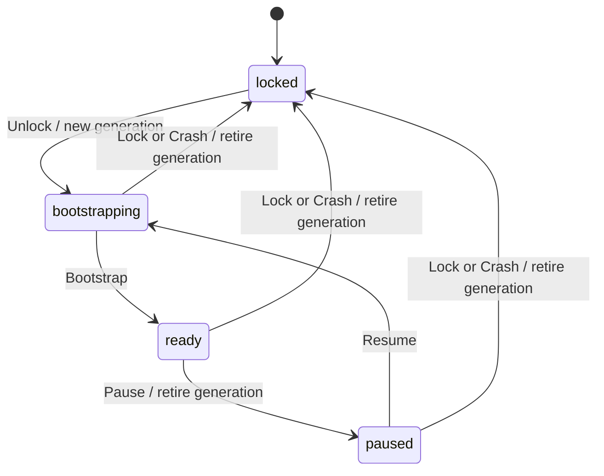
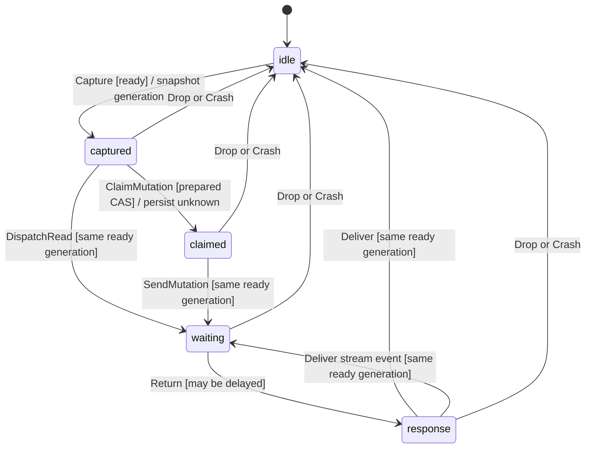
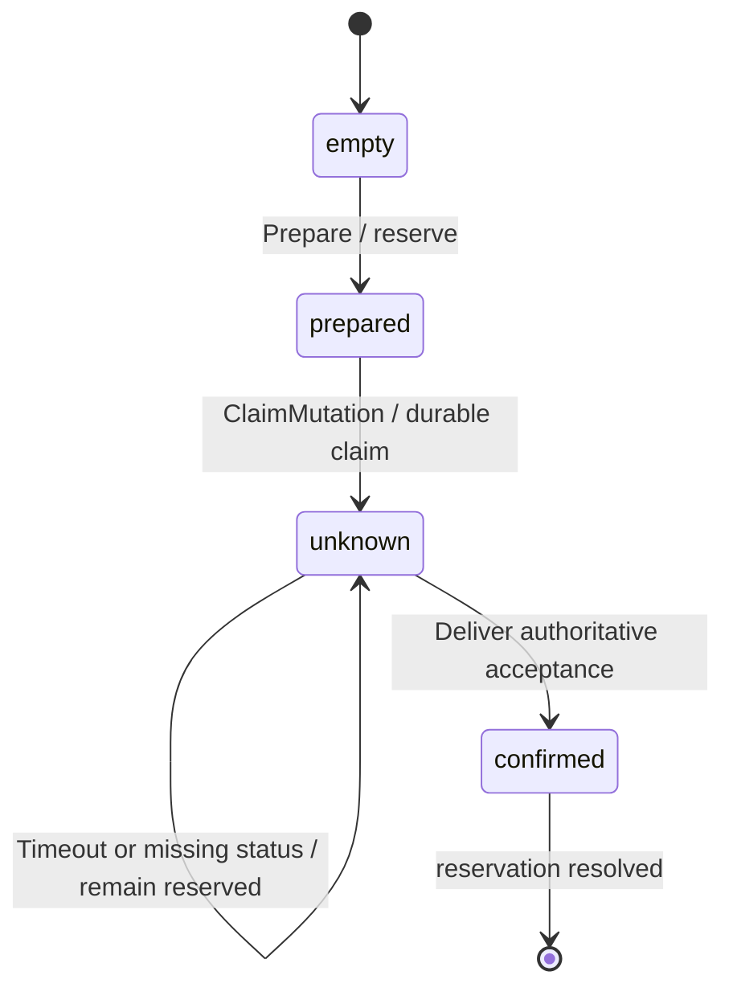

# Native session safety model

This is a bounded workflow model for the Shielded native host. It is not a proof of the implementation, Tor isolation, encryption, storage durability or complete wallet accounting.

## Action anchors

These are implementation anchors, not a checked refinement mapping. Paths are relative to the repository root.

| Model action | Owning file and symbol |
| --- | --- |
| `Unlock`, `Bootstrap`, `Resume` | `src-tauri/src/transport/mod.rs`: `PrivacyTransport::start`; `app/src/NativeWallet.tsx`: unlock/remount lifecycle |
| `Pause`, `Lock` | `src-tauri/src/transport/mod.rs`: `PrivacyTransport::pause`; `app/src/NativeWallet.tsx`: pause/lock callbacks |
| `Capture` | `src/native/transport.ts`: `NativeBridge::{fetch,open,sessionGuard}`; `src-tauri/src/transport/session.rs`: `Inner::register` |
| `DispatchRead`, `SendMutation` | `src-tauri/src/transport/session.rs`: `Inner::register`, `Lease::check`; `src-tauri/src/transport/wire.rs`: HTTP and stream dispatch |
| `Return`, `Deliver` | `src-tauri/src/transport/session.rs`: `Lease::check`; `src/native/transport.ts`: callback/status/session fences |
| `Drop` | `src-tauri/src/transport/mod.rs`: `PrivacyTransport::cancel` and retired-generation callback rejection |
| `Prepare`, `ClaimMutation` | `src/native/mutations.ts`: `makeNativeMutationJournal` / `beforeNativeMutation`; desktop single-instance host and synchronous journal claims prevent concurrent native realms |
| `ObserveUnconfirmed`, `TimeoutUnknown` | `src/native/mutations.ts`: `observeNativeResponse`, `reconcileNativeMutations`; `src/shielded/wallet.ts`: external nullifier/outpoint reservations |
| `AcceptRemote`, `LoseRemote` | External server/network behavior, outside native-process control |
| `Crash` | OS/process termination and subsequent startup; all journal values are assumed already durable |
| `Terminal` | Artificial bound termination; no implementation counterpart |

Concrete guard regressions live in `tests/native-transport.test.ts`, `tests/native-providers.test.ts`, `tests/tor-content.test.ts` and `tests/tor-mutations.test.ts`, plus the Rust transport tests. Desktop runtime testing confirmed a second launch exits while the first remains the only native process.

## Scope and assumptions

Two callback workers race one prepared mutation while issuing reads, status reads or streaming requests. Session states are `locked`, `bootstrapping`, `ready` and `paused`. Every invalidation retires the old generation. Request capture and dispatch are separate actions so a pause, lock or other worker can intervene between them. A response may arrive after invalidation.

Mutation preparation reserves its inputs. Claiming a mutation persists an unresolved journal state before its irreversible send. Remote acceptance is independent of request callbacks: the remote effect can occur after a pause, cancellation or process crash. A later authoritative status response may confirm it. A timeout or missing status does neither prove rejection nor release inputs.

The model includes process crashes, discarded callbacks, remote request loss, reply loss, delayed remote acceptance and concurrent stale reads of a mutation's prepared state. `Crash` removes process-local callback state while retaining the durable journal and pending remote request.

The model assumes:

- `Prepare` and the committed journal/claim update are atomic and durable. It does not prove IndexedDB, filesystem, fsync or native-vault behavior under power loss.
- A confirmation is authoritative evidence that this one mutation was accepted. Authentication, operation identifiers and endpoint semantics are abstracted.
- The transport performs no automatic mutation retry. There is one modeled dispatch attempt, not an entire sequence of separately authorized application recovery attempts.
- Lifecycle generation changes are atomic. The implementation must linearize them against dispatch and callback delivery.

`pc = waiting/response` represents a callback that may still arrive, not an open socket. The model proves rejection of stale callbacks and prevention of new dispatch after invalidation. It does **not** prove actual socket closure, task cancellation or absence of bytes from an already accepted remote operation after pause. Those need packaged-app runtime tests.

Current upstream `submitLightningSpend` deliberately posts its saved exact body after a status 404. The model does not verify that application reconciliation protocol or assume it has been removed. Its `prepared/included/dropped` record states also differ from this model's abstract `unknown` state. Do not claim `AtMostOneMutation` establishes globally at-most-once application submission. The concrete native layer must introduce no automatic replay, and application-level resubmission needs its own endpoint/idempotency argument.

The native journal treats generic `dropped` as unresolved: the operator can later correct it to `included` after adopting an abandoned batch (`src/rollup/service.ts`). Matching inclusion evidence or source-proven pre-admission refusal resolves that journal entry. This model does not establish the server evidence's authenticity or completeness.

Amounts, multiple operations, note conflicts across operations, cryptography, Tor circuits, connection pools, DNS, memory limits, network policy, mobile OS permissions and liveness are outside this model. No fairness assumptions or eventual-success promise is made.

## Statecharts







## Checks run

The checks used a SHA-256-pinned TLC v1.7.4 artifact (reporting TLC2 2.19) and Java 25 on November 6, 2026. With `TLC_JAR` pointing to `tla2tools.jar`, run the base configuration from the repository root:

```sh
java -cp "$TLC_JAR" tlc2.TLC -workers 2 -coverage 1 -config spec/tla/NativeSession.cfg spec/tla/NativeSession.tla
```

Each mutation configuration names its expected violated invariant on the first line. Run it with the same module and the corresponding `-config` path. `NativeSession_Sim.cfg` contains the wider bounds used for random simulation.

`node tools/check-native-model.mjs` downloads and verifies that pinned artifact, then runs the base and mutation configurations against their `EXPECT` headers. Set `TLC_JAR` to reuse a local copy with the same checksum. The native CI workflow runs this check on each PR; a wrong exit status or unexpected invariant violation fails the job.

| Check | Observed result |
| --- | --- |
| Exhaustive base, 2 workers, 3 generations, 1 timeout/missing-status observation | PASS: 432,590 generated states; 78,835 distinct; depth 24; queue empty |
| Coverage | Every semantic action has nonzero firings, including repeated `Unlock` (3,170), `Crash` (20,314) and `Deliver` (10,152) |
| Guard sweep | PASS: 7 configurations, 0 mismatches: base green plus 6 intended invariant violations |
| Wider random simulation, 4 workers, 6 generations, 3 observations | PASS: 20,000 traces at depth 100, seed 20261106; 2,107,683 states checked |

`Terminal` is an artificial self-loop at the generation bound: it fired 21,612 times and creates zero novel states by construction. It prevents finite-bound terminal states from being mistaken for deadlocks; it is not a product action. Coverage reports show `new states:firings`; zero *novel* states for this self-loop is expected.

The first 2-generation run passed but did not include lock → unlock or crash → relaunch. Independent review caught that bound and the final exhaustive run uses 3. The first mutation sweep exposed a TLA boolean-assignment precedence error; parenthesized assignments fixed the model before the recorded final sweep. Neither issue was suppressed by weakening an invariant.

The `trace-*.md` files retain the six counterexamples. Simulation extends exploration; it does not exhaustively check the wider bounds.

## Guard counterexamples and implementation tests

Every mutation changes one constant. Each corresponding `.cfg` has an expected invariant name; all six matched. The trace files were generated by TLC's single-worker shortest-counterexample mode.

| Mutation and trace | Short failure sequence | Real regression test to add |
| --- | --- | --- |
| `NoDispatchFence`; `trace-NoDispatchFence.md` | Capture → Pause → DispatchRead | Queue a request, pause before dispatch, and assert no connector invocation |
| `NoDeliveryFence`; `trace-NoDeliveryFence.md` | DispatchRead → Pause → Return → Deliver | Deliver a delayed HTTP/stream callback after pause and after a new session, asserting neither updates the consumer |
| `NoClaimCAS`; `trace-NoClaimCAS.md` | Both workers capture prepared → both claim → both send | Race two dispatch owners for one prepared attempt; only one irreversible dispatch may win |
| `NoDurableJournal`; `trace-NoDurableJournal.md` | Capture → claim without persisted unknown → SendMutation | Hold/fail journal persistence and assert mutation dispatch has not started |
| `RetryUnknown`; `trace-RetryUnknown.md` | ClaimMutation → TimeoutUnknown → requeue | Drop a mutation response; native transport must return uncertainty without a second send |
| `ReleaseUnknown`; `trace-ReleaseUnknown.md` | ClaimMutation → ObserveUnconfirmed → release | Return missing/unavailable status after an uncertain send; application inputs remain reserved |

These are abstract counterexamples to deliberately weakened rules, not discovered implementation vulnerabilities. The action-to-code table and tests must be reconciled with the actual transport and journal boundaries before using this model as implementation evidence.
