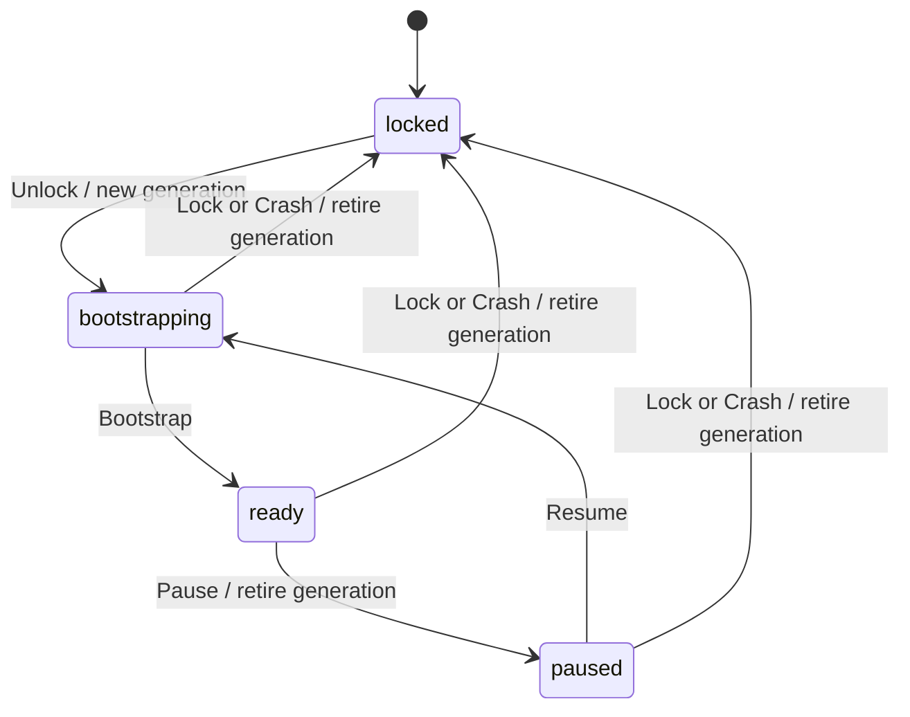
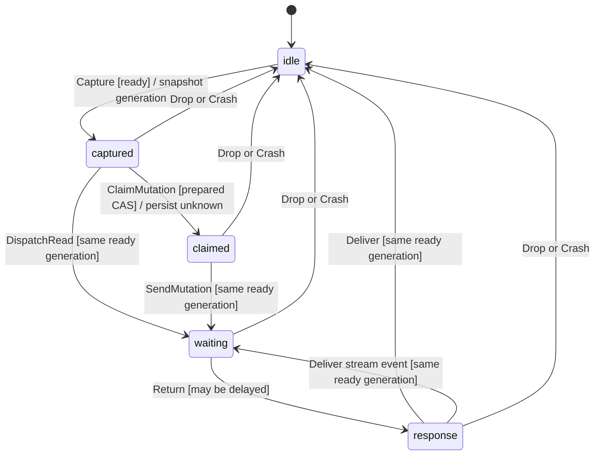
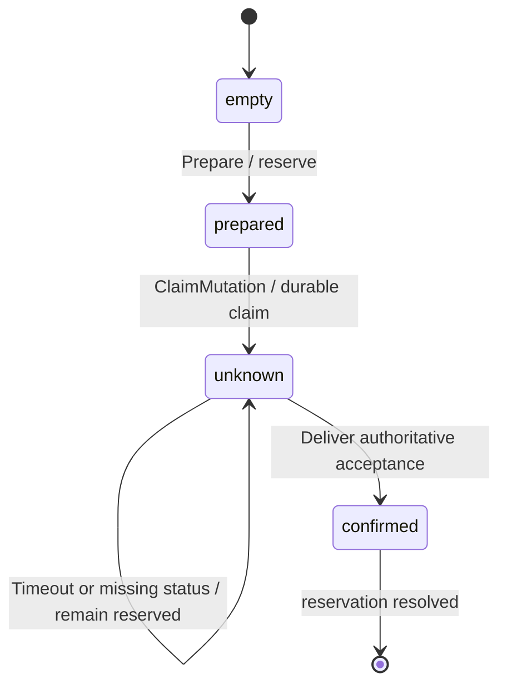
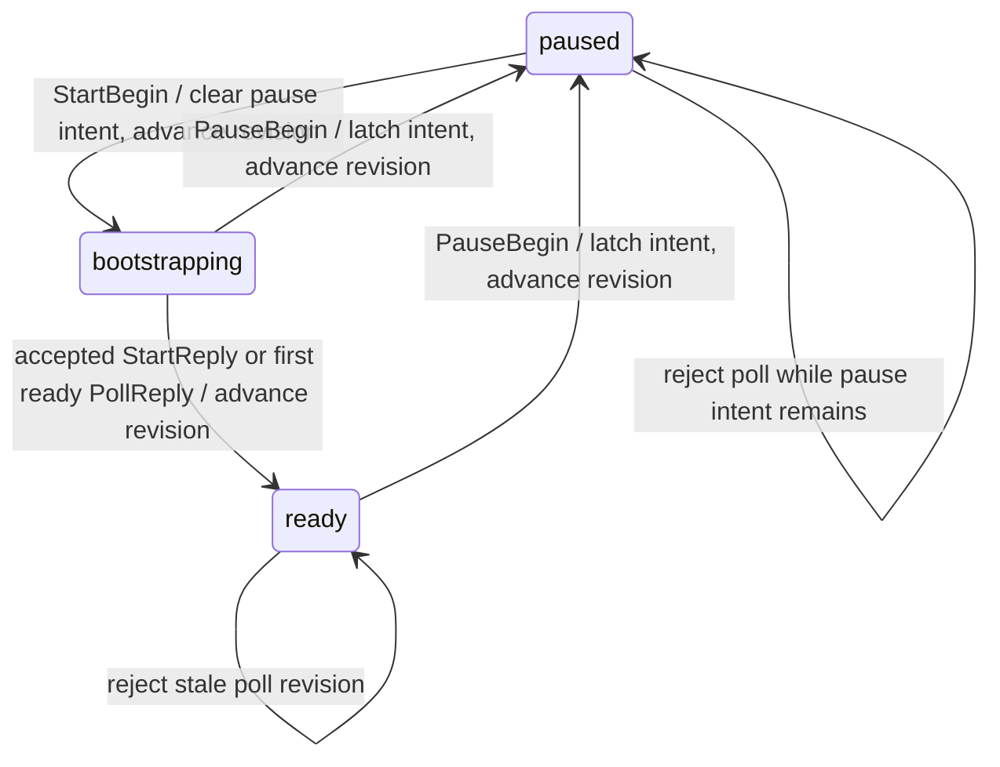
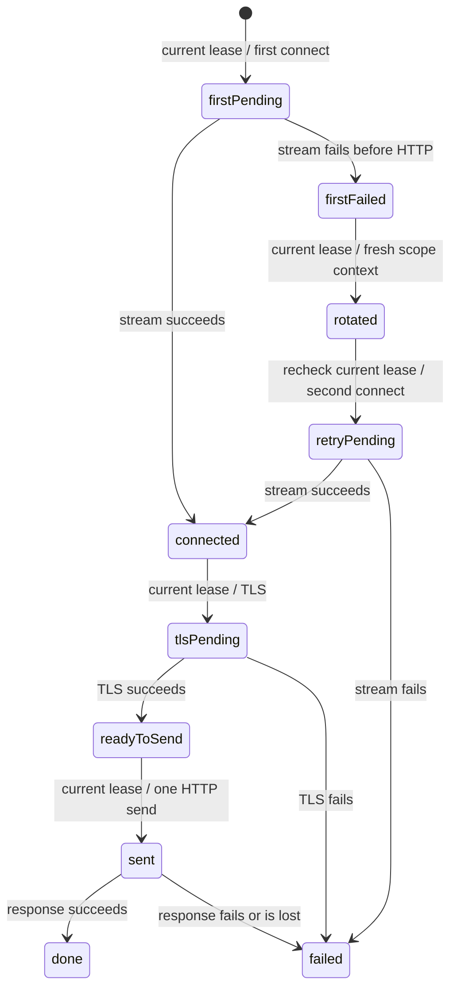
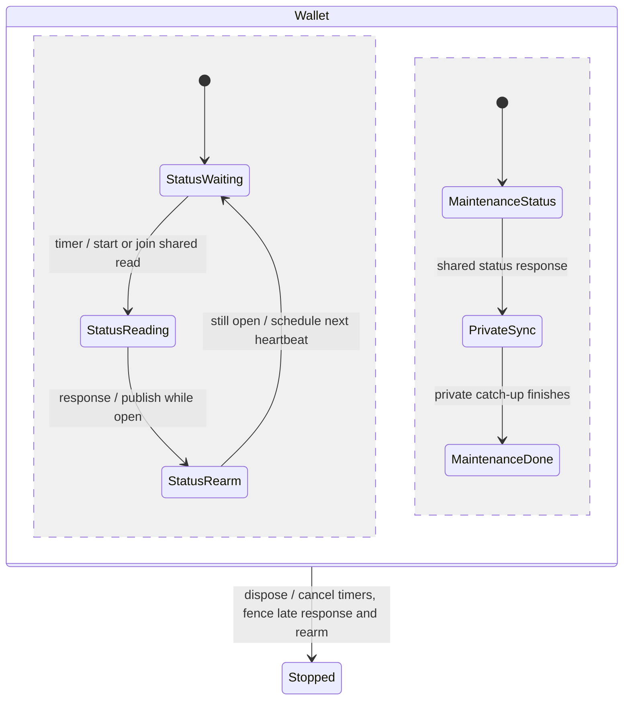
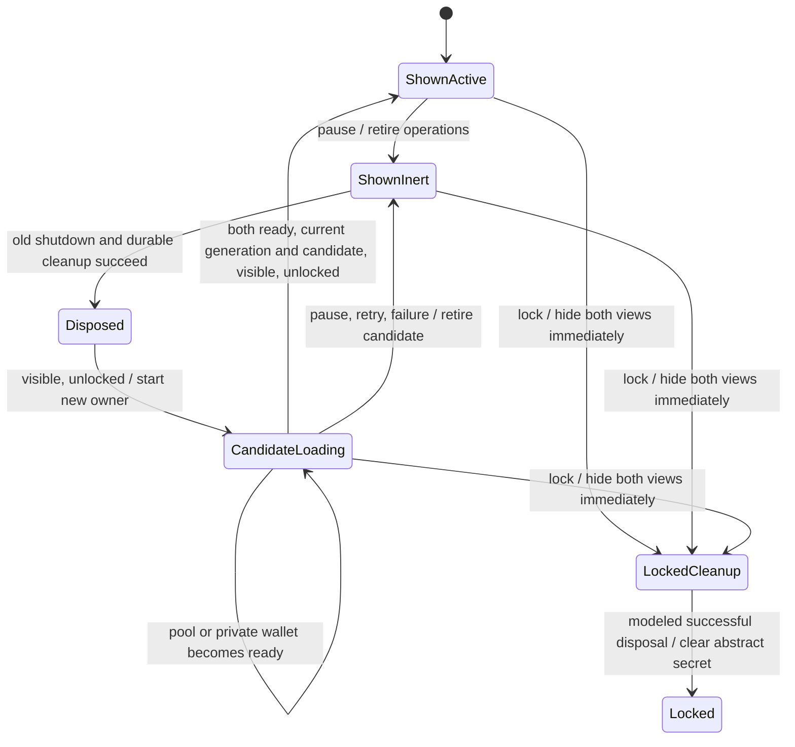

# Native session safety model

This is a bounded workflow model for the Shielded native host. It is not a proof of the implementation, Tor isolation, encryption, storage durability or complete wallet accounting.

## Action anchors

These are implementation anchors, not a checked refinement mapping. Paths are relative to the repository root.

| Model action | Owning file and symbol |
| --- | --- |
| `Unlock`, `Bootstrap`, `Resume` | `src-tauri/src/transport/mod.rs`: `PrivacyTransport::start`; `app/src/NativeWallet.tsx`: unlock/remount lifecycle |
| `Pause`, `Lock` | `src-tauri/src/transport/mod.rs`: `PrivacyTransport::pause`; `app/src/NativeWallet.tsx`: pause/lock callbacks |
| `Capture` | `src/native/transport.ts`: `NativeBridge::{fetch,open,sessionGuard}`; `src-tauri/src/transport/session.rs`: `Inner::register` |
| `DispatchRead`, `SendMutation` | `src-tauri/src/transport/session.rs`: `Inner::register`, `Lease::check`; `src-tauri/src/transport/wire.rs`: HTTP and stream dispatch |
| `Return`, `Deliver` | `src-tauri/src/transport/session.rs`: `Lease::check`; `src/native/transport.ts`: callback/status/session fences |
| `Drop` | `src-tauri/src/transport/mod.rs`: `PrivacyTransport::cancel` and retired-generation callback rejection |
| `Prepare`, `ClaimMutation` | `src/native/mutations.ts`: `makeNativeMutationJournal` / `beforeNativeMutation`; desktop single-instance host and synchronous journal claims prevent concurrent native realms |
| `ObserveUnconfirmed`, `TimeoutUnknown` | `src/native/mutations.ts`: `observeNativeResponse`, `reconcileNativeMutations`; `src/shielded/wallet.ts`: external nullifier/outpoint reservations |
| `AcceptRemote`, `LoseRemote` | External server/network behavior, outside native-process control |
| `Crash` | OS/process termination and subsequent startup; all journal values are assumed already durable |
| `Terminal` | Artificial bound termination; no implementation counterpart |

Concrete guard regressions live in `tests/native-transport.test.ts`, `tests/native-providers.test.ts`, `tests/tor-content.test.ts` and `tests/tor-mutations.test.ts`, plus the Rust transport tests. Desktop runtime testing confirmed a second launch exits while the first remains the only native process.

## Scope and assumptions

Two callback workers race one prepared mutation while issuing reads, status reads or streaming requests. Session states are `locked`, `bootstrapping`, `ready` and `paused`. Every invalidation retires the old generation. Request capture and dispatch are separate actions so a pause, lock or other worker can intervene between them. A response may arrive after invalidation.

Mutation preparation reserves its inputs. Claiming a mutation persists an unresolved journal state before its irreversible send. Remote acceptance is independent of request callbacks: the remote effect can occur after a pause, cancellation or process crash. A later authoritative status response may confirm it. A timeout or missing status does neither prove rejection nor release inputs.

The model includes process crashes, discarded callbacks, remote request loss, reply loss, delayed remote acceptance and concurrent stale reads of a mutation's prepared state. `Crash` removes process-local callback state while retaining the durable journal and pending remote request.

The model assumes:

- `Prepare` and the committed journal/claim update are atomic and durable. It does not prove IndexedDB, filesystem, fsync or native-vault behavior under power loss.
- A confirmation is authoritative evidence that this one mutation was accepted. Authentication, operation identifiers and endpoint semantics are abstracted.
- The transport performs no automatic mutation retry. There is one modeled dispatch attempt, not an entire sequence of separately authorized application recovery attempts.
- Lifecycle generation changes are atomic. The implementation must linearize them against dispatch and callback delivery.

`pc = waiting/response` represents a callback that may still arrive, not an open socket. The model proves rejection of stale callbacks and prevention of new dispatch after invalidation. It does **not** prove actual socket closure, task cancellation or absence of bytes from an already accepted remote operation after pause. Those need packaged-app runtime tests.

Current upstream `submitLightningSpend` deliberately posts its saved exact body after a status 404. The model does not verify that application reconciliation protocol or assume it has been removed. Its `prepared/included/dropped` record states also differ from this model's abstract `unknown` state. Do not claim `AtMostOneMutation` establishes globally at-most-once application submission. The concrete native layer must introduce no automatic replay, and application-level resubmission needs its own endpoint/idempotency argument.

The native journal treats generic `dropped` as unresolved: the operator can later correct it to `included` after adopting an abandoned batch (`src/rollup/service.ts`). Matching inclusion evidence or source-proven pre-admission refusal resolves that journal entry. This model does not establish the server evidence's authenticity or completeness.

Amounts, multiple operations, note conflicts across operations, cryptography, Tor circuits, connection pools, DNS, memory limits, network policy, mobile OS permissions and liveness are outside this model. No fairness assumptions or eventual-success promise is made.

## Statecharts







## Checks run

The checks used a SHA-256-pinned TLC v1.7.4 artifact (reporting TLC2 2.19) and Java 25 on November 6, 2026. With `TLC_JAR` pointing to `tla2tools.jar`, run the base configuration from the repository root:

```sh
java -cp "$TLC_JAR" tlc2.TLC -workers 2 -coverage 1 -config spec/tla/NativeSession.cfg spec/tla/NativeSession.tla
```

Each mutation configuration names its expected violated invariant on the first line. Run it with the same module and the corresponding `-config` path. `NativeSession_Sim.cfg` contains the wider bounds used for random simulation.

`node tools/check-native-model.mjs` downloads and verifies that pinned artifact, then runs the base and mutation configurations against their `EXPECT` headers. Set `TLC_JAR` to reuse a local copy with the same checksum. The native CI workflow runs this check on each PR; a wrong exit status or unexpected invariant violation fails the job.

| Check | Observed result |
| --- | --- |
| Exhaustive base, 2 workers, 3 generations, 1 timeout/missing-status observation | PASS: 432,590 generated states; 78,835 distinct; depth 24; queue empty |
| Coverage | Every semantic action has nonzero firings, including repeated `Unlock` (3,170), `Crash` (20,314) and `Deliver` (10,152) |
| Guard sweep | PASS: 7 configurations, 0 mismatches: base green plus 6 intended invariant violations |
| Wider random simulation, 4 workers, 6 generations, 3 observations | PASS: 20,000 traces at depth 100, seed 20261106; 2,107,683 states checked |

`Terminal` is an artificial self-loop at the generation bound: it fired 21,612 times and creates zero novel states by construction. It prevents finite-bound terminal states from being mistaken for deadlocks; it is not a product action. Coverage reports show `new states:firings`; zero *novel* states for this self-loop is expected.

The first 2-generation run passed but did not include lock → unlock or crash → relaunch. Independent review caught that bound and the final exhaustive run uses 3. The first mutation sweep exposed a TLA boolean-assignment precedence error; parenthesized assignments fixed the model before the recorded final sweep. Neither issue was suppressed by weakening an invariant.

The `trace-*.md` files retain the six counterexamples. Simulation extends exploration; it does not exhaustively check the wider bounds.

## Guard counterexamples and implementation tests

Every mutation changes one constant. Each corresponding `.cfg` has an expected invariant name; all six matched. The trace files were generated by TLC's single-worker shortest-counterexample mode.

| Mutation and trace | Short failure sequence | Real regression test to add |
| --- | --- | --- |
| `NoDispatchFence`; `trace-NoDispatchFence.md` | Capture → Pause → DispatchRead | Queue a request, pause before dispatch, and assert no connector invocation |
| `NoDeliveryFence`; `trace-NoDeliveryFence.md` | DispatchRead → Pause → Return → Deliver | Deliver a delayed HTTP/stream callback after pause and after a new session, asserting neither updates the consumer |
| `NoClaimCAS`; `trace-NoClaimCAS.md` | Both workers capture prepared → both claim → both send | Race two dispatch owners for one prepared attempt; only one irreversible dispatch may win |
| `NoDurableJournal`; `trace-NoDurableJournal.md` | Capture → claim without persisted unknown → SendMutation | Hold/fail journal persistence and assert mutation dispatch has not started |
| `RetryUnknown`; `trace-RetryUnknown.md` | ClaimMutation → TimeoutUnknown → requeue | Drop a mutation response; native transport must return uncertainty without a second send |
| `ReleaseUnknown`; `trace-ReleaseUnknown.md` | ClaimMutation → ObserveUnconfirmed → release | Return missing/unavailable status after an uncertain send; application inputs remain reserved |

These are abstract counterexamples to deliberately weakened rules, not discovered implementation vulnerabilities. The action-to-code table and tests must be reconciled with the actual transport and journal boundaries before using this model as implementation evidence.

## Tor status ordering

`TorStatus.tla` models one start and one pause with two delayed status RPCs and a revision bound of four. Renderer phase and native phase are separate. Poll revision capture, native snapshot and renderer delivery are distinct actions. Native pause can succeed or fail while bootstrap completion and start replies race it. A retained local pause intent blocks status updates through either outcome until an explicit start clears it.

| Model action | Owning file and symbol |
| --- | --- |
| `StartBegin`, `StartReply` | `src/native/transport.ts`: `NativeBridge.start` |
| `NativeProgress`, `NativeReady` | `src-tauri/src/transport/session.rs`: `Inner::start`, bootstrap progress |
| `PollBegin`, `PollSnapshot`, `PollReply` | `src/native/transport.ts`: `NativeBridge.status`, `NativeBridge.acceptStatus`; native `native_status` |
| `PauseBegin`, `PauseReply` | `src/native/transport.ts`: `NativeBridge.pause` |
| `NativePause`, `NativePauseFailure` | `src-tauri/src/transport/session.rs`: `Inner::pause`; failed IPC/native call |



The first accepted ready observation, including a poll before the start reply, invalidates older bootstrap snapshots. Start and pause begin/completion also fence earlier status replies. The pause-intent latch additionally blocks a fresh ready response after a failed pause; revision matching alone cannot protect that case. Transient pause and completion fences are retained in the model, but the persistent latch makes their individual removal redundant for these properties.

The pinned TLC runner and Java 25 checked the following on November 6, 2026:

| Configuration | Observed result |
| --- | --- |
| `TorStatus.cfg` | PASS: 82,529 generated; 19,350 distinct; depth 14; queue empty; all 11 semantic actions fired |
| `TorStatus_NoRevisionGuard.cfg` | `ReadyNeverRegresses` violated: capture bootstrap at revision 1 → start reply publishes ready at revision 2 → old bootstrap reply clears ready contexts |
| `TorStatus_NoPauseIntent.cfg` | `NoReadyAfterPause` violated: pause begins → native pause fails → pause reply completes at revision 3 → fresh revision-3 poll returns native ready and restores contexts |

```sh
node /path/to/tla-model/scripts/tla.mjs check spec/tla/TorStatus --workers 2 --coverage
node /path/to/tla-model/scripts/tla.mjs trace spec/tla/TorStatus --cfg TorStatus_NoRevisionGuard.cfg
node /path/to/tla-model/scripts/tla.mjs trace spec/tla/TorStatus --cfg TorStatus_NoPauseIntent.cfg
```

The model checks status ordering and readiness capability retention. Native generations, repeated starts/resumes, overlapping pause calls, start failures, network reachability, UI rendering, circuit isolation and liveness are outside this bounded model. Implementation tests must drive the same delayed-reply and failed-pause sequences; these results are not an implementation proof.

## Tor connection recovery

`TorConnect.tla` models one lease and at most two Tor stream connection attempts. A failed first attempt can rotate the scope to a fresh isolation context before a single retry. Rotation and retry dispatch are separate steps; pause, cancellation or scope closure can intervene. An external recovery represents another active lease already replacing the original scope client. TLS and HTTP outcomes occur after connection success, and neither failure can return to the connection retry path.

| Model action | Owning file and symbol |
| --- | --- |
| `FirstConnect`, `RetryConnect`, connection outcomes | `src-tauri/src/transport/session.rs`: `Lease::connect_with_recovery`; `wire.rs`: `exchange`, `socket_inner` |
| `RotateScope`, `OtherRecovery` | `src-tauri/src/transport/session.rs`: `Lease::reconnect_client` |
| `StartTLS`, `TLSResult` | `src-tauri/src/transport/wire.rs`: `exchange`, `TlsConnector::connect` |
| `SendHTTP`, `HTTPResult` | `src-tauri/src/transport/wire.rs`: `exchange`, `send_http`, `http` |
| `Pause`, `Cancel`, `CloseScope` | `src-tauri/src/transport/session.rs`: `Inner::{pause,cancel,close_scope}` |



Pinned TLC v1.7.4 checked the base on November 6, 2026: 766 generated states, 240 distinct states, depth 13 and an empty queue. Every semantic action fired. `Terminal` is an artificial stuttering action. The base preserves `NoRetiredReconnect`, `RetryUsesFreshScope`, `NoRequestBeforeConnected` and `AtMostOneHTTPSend`.

| Mutation | Short counterexample |
| --- | --- |
| `TorConnect_NoRetryFence.cfg` | First connect fails → rotate → pause → second connect is dispatched with a retired lease; `NoRetiredReconnect` fails |
| `TorConnect_NoFreshScope.cfg` | First connect fails → rotation retains the original context → second connect uses it; `RetryUsesFreshScope` fails |

Both deliberately weakened configurations exit 12 with their named invariant. Single-send behavior and the TLS-before-HTTP ordering are structural in this model; no artificial replay transition was added merely to manufacture another failing mutation.

This is a bounded authorization and ordering model, not an implementation proof. It abstracts connection failures and timeouts as outcomes, actual Tor circuits and exit selection, DNS, concurrent HTTP operations, storage, TLS correctness and liveness. Context `0` denotes the lease's original client and `1` a replacement, without asserting a different exit address. A retirement blocks a later logical retry dispatch; the model does not claim that previously authorized network work emits no bytes after pause.

## Wallet status heartbeat

`WalletStatus.tla` separates one maintenance tick from a recurring public-status heartbeat. Both callers share a pending read. Private catch-up may remain blocked indefinitely while status responses continue; disposal can intervene before a response or timer rearm.

| Model action | Owning file and symbol |
| --- | --- |
| `StartMaintenance` | `src/shielded/wallet.ts`: `ShieldedWallet.tick`, `refreshPoolStatus` |
| `StartHeartbeat` | `src/shielded/wallet.ts`: `ShieldedWallet.statusTick`, `refreshPoolStatus` |
| `StatusResult` | `src/shielded/wallet.ts`: `ShieldedWallet.refreshPoolStatus` publication fence |
| `ArmHeartbeat` | `src/shielded/wallet.ts`: `ShieldedWallet.statusTick` timer fence |
| `PrivateComplete` | `src/shielded/wallet.ts`: `ShieldedWallet.tick` after `load`/`sync` |
| `Stop` | `src/shielded/wallet.ts`: `ShieldedWallet.dispose` |



The clock starts at a watchdog deadline; each unit is one refresh interval. This model assumes a responsive public endpoint and a scheduler that processes due public work before the next clock unit. `AdvanceClock` enforces that latency bound, while weak fairness requires enabled status actions to progress. The private sync has no fairness requirement. `PulseProgress` checks that a due heartbeat eventually publishes even when private work never completes; `FreshWhileSyncing` checks that two intervals cannot pass without fresh status under these assumptions. Real Tor delays, failed status reads, head-expiry revision races and financial operations are outside this model.

Pinned TLC v1.7.4 checked the base on November 6, 2026: 731 generated states, 254 distinct states, depth 19, an empty queue and all four temporal branches checked. Every semantic action fired: maintenance start 16, heartbeat start 40, response 110, rearm 16, private completion 77, clock advance 147 and stop 79. `Terminal` is an artificial stuttering action (257 firings). The base preserves one status read, publication and timer shutdown fences, and fresh status during blocked catch-up.

| Mutation | Short counterexample |
| --- | --- |
| `WalletStatus_Coupled.cfg` | Maintenance status succeeds → private sync remains blocked → two clock advances without a heartbeat → `FreshWhileSyncing` fails |
| `WalletStatus_NoSingleFlight.cfg` | Maintenance starts a read → heartbeat starts another before its response → `OneStatusRead` fails |
| `WalletStatus_NoPublishFence.cfg` | Start read → stop → response publishes → `NoStatusAfterStop` fails |
| `WalletStatus_NoTimerFence.cfg` | Heartbeat response → stop → rearm → `NoTimerAfterStop` fails |

All four mutations exit 12 with their named invariant. Their shortest traces are retained with the external native QA artifacts. The first shutdown mutations exposed an unparenthesized boolean assignment in the model; it was corrected before the recorded checks. The wider `WalletStatus_Sim.cfg` passed 20,000 traces at depth 100 with seed 20261106 and 2,081,629 states checked. It uses six clock intervals; random simulation supplements the exhaustive base and does not prove wider liveness.

## Native wallet view handoff

`NativeViewHandoff.tla` separates an already-mounted wallet from a replacement candidate and its operational owner. Suspend, failed startup and repeated resume retire operations while retaining the old render as inert. Provider creation waits for every previous owner to dispose and a native generation newer than the previous owner's. A candidate replaces the shown wallet only after both pool and private-wallet readiness, with current generation, candidate identity, visibility and lock checks. Lock immediately revokes the candidate and hides both views. `FinishLock` models clearing the abstract retained secret after successful operational disposal; it does not model the source's behavior when cleanup rejects.

The source has a different cache-clearing policy on failure: `NativeWallet.pause` calls `previous?.cache.clearMemory()` in the `finally` of an aggregate promise. It clears on rejection as well as fulfillment, and the aggregate may reject before all other tasks settle. `createNativeCleanup` retains failed tasks, and `NativeWallet.open` drains them before creating new providers. The model checks the ownership handoff and its successful cleanup path; `LockClearsAfterCleanup` does not certify the actual cache-clearing order on failed cleanup. That source policy is unchanged by this handoff change.

| Model action | Owning file and symbol |
| --- | --- |
| `Hide`, `Foreground`, `StartNative` | `app/src/NativeWallet.tsx`: visibility handler and `open` |
| `Retire`, `BeginCandidate` | `app/src/native-view-handoff.ts`: `createNativeViewHandoff` / `retire`, `discard`, `stage`; `NativeWallet.tsx`: cleanup before `open` |
| `Dispose`, `Unmount` | `app/src/native-view-handoff.ts`: per-view `onShutdown` ownership; `app/src/RollupWallet.tsx`: shutdown and unmount callbacks |
| `PoolReady`, `WalletReady`, `CaptureReady`, `DeliverReady` | `app/src/RollupWallet.tsx`: `onReady`; `app/src/native-view-handoff.ts`: `promote`; `NativeWallet.tsx`: readiness guard |
| `LockIntent` | `app/src/NativeWallet.tsx`: lock callback and immediate view retirement |
| `FinishLock` | Successful-cleanup abstraction only; `NativeWallet.pause` has the different rejection policy described above |



Two callback actors race at most three operational owners and three native generations in the exhaustive base. Callback capture and delivery are separate steps. Native generation changes, visibility changes, late readiness, candidate retirement and old unmount callbacks can intervene independently. `retained` and `bad` are history variables for view continuity and activation authorization. `DropReady` and `Terminal` represent discarded callbacks and stuttering. All semantic actions fired, including 4,760 callback drops; a zero count of newly discovered states for that action does not mean it was disabled.

Pinned TLC v1.7.4 checked the base on November 8, 2026: 29,415 generated states, 3,837 distinct states, depth 21 and an empty queue. The eight guard mutations each exit 12 with the named invariant:

| Configuration | Shortest counterexample |
| --- | --- |
| `NativeViewHandoff_NoGeneration.cfg` | Stage candidate → native generation advances → old generation promotes; `NoStaleGeneration` fails (10 states) |
| `NativeViewHandoff_NoVisibility.cfg` | Stage candidate → hide → readiness promotes; `NoHiddenActivation` fails (10 states) |
| `NativeViewHandoff_NoLock.cfg` | Lock → dispose → admit candidate while locked → readiness promotes; `NoLockedActivation` fails (9 states) |
| `NativeViewHandoff_NoCandidate.cfg` | Stage → retire candidate → old readiness promotes; `OnlyCurrentCandidate` fails (10 states) |
| `NativeViewHandoff_NoReadiness.cfg` | Stage → callback promotes before either readiness result; `ReadyBeforePromotion` fails (7 states) |
| `NativeViewHandoff_NoDisposal.cfg` | Start native generation → stage new owner before old disposal; `DisposeBeforeNewOwner` fails (3 states) |
| `NativeViewHandoff_NoShutdownOwner.cfg` | Dispose old owner → stage new owner → old unmount clears new shutdown handle; `ShutdownOwnerPreserved` fails (6 states) |
| `NativeViewHandoff_NoRetainedView.cfg` | Pause drops the old view; `RetainUntilReady` fails (2 states) |

The lock mutation removes the unlocked guard from both candidate admission and promotion; immediate candidate revocation also fences previously captured callbacks. The wider configuration passed 20,000 traces at depth 100 with four actors, five owners, five generations and seed 20261108: 2,005,317 states checked. The native CI gate now matches 27 expected configurations, compared with the 18-configuration baseline.

This is a bounded ownership and view-continuity model. It abstracts React rendering and inert behavior, provider internals, actual pool and wallet readiness, transport failure details, vault durability and financial protocols. First unlock, onboarding, mode-switch teardown and cache clearing after rejected cleanup are outside its scope. Disposal is an acknowledged success, so an owner whose cleanup has not succeeded continues to block a new owner. No fairness or recovery liveness is claimed. The action anchors identify related source; they are not a checked refinement mapping. These results do not prove the implementation, secret zeroization or physical-device behavior.
