# Native session safety model

This is a bounded workflow model for the Shielded native host. It is not a proof of the implementation, Tor isolation, encryption, storage durability or complete wallet accounting.

## Action anchors

These are implementation anchors, not a checked refinement mapping. Paths are relative to the repository root.

| Model action | Owning file and symbol |
| --- | --- |
| `Unlock`, `Bootstrap`, `Resume` | `src-tauri/src/transport/mod.rs`: `PrivacyTransport::start`; `app/src/NativeWallet.tsx`: unlock/remount lifecycle |
| `Pause`, `Lock` | `src-tauri/src/transport/mod.rs`: `PrivacyTransport::pause`; `app/src/NativeWallet.tsx`: pause/lock callbacks |
| `Capture` | `src/native/transport.ts`: `NativeBridge::{fetch,open,sessionGuard}`; `src-tauri/src/transport/session.rs`: `Inner::register` |
| `DispatchRead`, `SendMutation` | `src-tauri/src/transport/session.rs`: `Inner::register`, `Lease::check`; `src-tauri/src/transport/wire.rs`: HTTP and stream dispatch |
| `Return`, `Deliver` | `src-tauri/src/transport/session.rs`: `Lease::check`; `src/native/transport.ts`: callback/status/session fences |
| `Drop` | `src-tauri/src/transport/mod.rs`: `PrivacyTransport::cancel` and retired-generation callback rejection |
| `Prepare`, `ClaimMutation` | `src/native/mutations.ts`: `makeNativeMutationJournal` / `beforeNativeMutation`; desktop single-instance host and synchronous journal claims prevent concurrent native realms |
| `ObserveUnconfirmed`, `TimeoutUnknown` | `src/native/mutations.ts`: `observeNativeResponse`, `reconcileNativeMutations`; `src/shielded/wallet.ts`: external nullifier/outpoint reservations |
| `AcceptRemote`, `LoseRemote` | External server/network behavior, outside native-process control |
| `Crash` | OS/process termination and subsequent startup; all journal values are assumed already durable |
| `Terminal` | Artificial bound termination; no implementation counterpart |

Concrete guard regressions live in `tests/native-transport.test.ts`, `tests/native-providers.test.ts`, `tests/tor-content.test.ts` and `tests/tor-mutations.test.ts`, plus the Rust transport tests. Desktop runtime testing confirmed a second launch exits while the first remains the only native process.

## Scope and assumptions

Two callback workers race one prepared mutation while issuing reads, status reads or streaming requests. Session states are `locked`, `bootstrapping`, `ready` and `paused`. Every invalidation retires the old generation. Request capture and dispatch are separate actions so a pause, lock or other worker can intervene between them. A response may arrive after invalidation.

Mutation preparation reserves its inputs. Claiming a mutation persists an unresolved journal state before its irreversible send. Remote acceptance is independent of request callbacks: the remote effect can occur after a pause, cancellation or process crash. A later authoritative status response may confirm it. A timeout or missing status does neither prove rejection nor release inputs.

The model includes process crashes, discarded callbacks, remote request loss, reply loss, delayed remote acceptance and concurrent stale reads of a mutation's prepared state. `Crash` removes process-local callback state while retaining the durable journal and pending remote request.

The model assumes:

- `Prepare` and the committed journal/claim update are atomic and durable. It does not prove IndexedDB, filesystem, fsync or native-vault behavior under power loss.
- A confirmation is authoritative evidence that this one mutation was accepted. Authentication, operation identifiers and endpoint semantics are abstracted.
- The transport performs no automatic mutation retry. There is one modeled dispatch attempt, not an entire sequence of separately authorized application recovery attempts.
- Lifecycle generation changes are atomic. The implementation must linearize them against dispatch and callback delivery.

`pc = waiting/response` represents a callback that may still arrive, not an open socket. The model proves rejection of stale callbacks and prevention of new dispatch after invalidation. It does **not** prove actual socket closure, task cancellation or absence of bytes from an already accepted remote operation after pause. Those need packaged-app runtime tests.

Current upstream `submitLightningSpend` deliberately posts its saved exact body after a status 404. The model does not verify that application reconciliation protocol or assume it has been removed. Its `prepared/included/dropped` record states also differ from this model's abstract `unknown` state. Do not claim `AtMostOneMutation` establishes globally at-most-once application submission. The concrete native layer must introduce no automatic replay, and application-level resubmission needs its own endpoint/idempotency argument.

The native journal treats generic `dropped` as unresolved: the operator can later correct it to `included` after adopting an abandoned batch (`src/rollup/service.ts`). Matching inclusion evidence or source-proven pre-admission refusal resolves that journal entry. This model does not establish the server evidence's authenticity or completeness.

Amounts, multiple operations, note conflicts across operations, cryptography, Tor circuits, connection pools, DNS, memory limits, network policy, mobile OS permissions and liveness are outside this model. No fairness assumptions or eventual-success promise is made.

## Statecharts

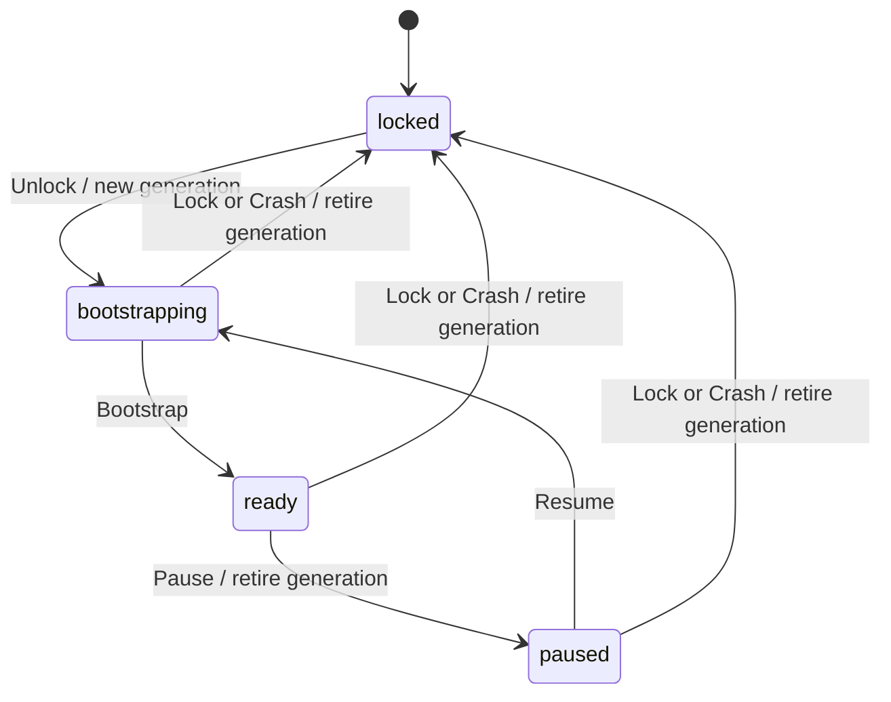

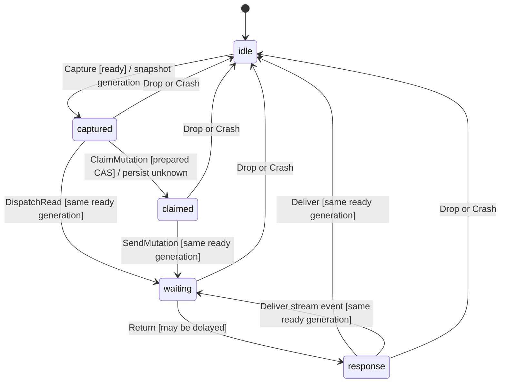

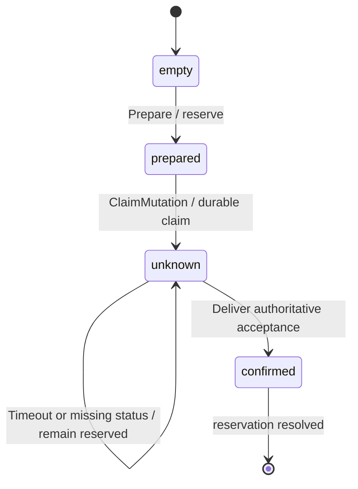

## Checks run

The checks used a SHA-256-pinned TLC v1.7.4 artifact (reporting TLC2 2.19) and Java 25 on November 6, 2026. With `TLC_JAR` pointing to `tla2tools.jar`, run the base configuration from the repository root:

```sh
java -cp "$TLC_JAR" tlc2.TLC -workers 2 -coverage 1 -config spec/tla/NativeSession.cfg spec/tla/NativeSession.tla
```

Each mutation configuration names its expected violated invariant on the first line. Run it with the same module and the corresponding `-config` path. `NativeSession_Sim.cfg` contains the wider bounds used for random simulation.

`node tools/check-native-model.mjs` downloads and verifies that pinned artifact, then runs the base and mutation configurations against their `EXPECT` headers. Set `TLC_JAR` to reuse a local copy with the same checksum. The native CI workflow runs this check on each PR; a wrong exit status or unexpected invariant violation fails the job.

| Check | Observed result |
| --- | --- |
| Exhaustive base, 2 workers, 3 generations, 1 timeout/missing-status observation | PASS: 432,590 generated states; 78,835 distinct; depth 24; queue empty |
| Coverage | Every semantic action has nonzero firings, including repeated `Unlock` (3,170), `Crash` (20,314) and `Deliver` (10,152) |
| Guard sweep | PASS: 7 configurations, 0 mismatches: base green plus 6 intended invariant violations |
| Wider random simulation, 4 workers, 6 generations, 3 observations | PASS: 20,000 traces at depth 100, seed 20261106; 2,107,683 states checked |

`Terminal` is an artificial self-loop at the generation bound: it fired 21,612 times and creates zero novel states by construction. It prevents finite-bound terminal states from being mistaken for deadlocks; it is not a product action. Coverage reports show `new states:firings`; zero *novel* states for this self-loop is expected.

The first 2-generation run passed but did not include lock → unlock or crash → relaunch. Independent review caught that bound and the final exhaustive run uses 3. The first mutation sweep exposed a TLA boolean-assignment precedence error; parenthesized assignments fixed the model before the recorded final sweep. Neither issue was suppressed by weakening an invariant.

The `trace-*.md` files retain the six counterexamples. Simulation extends exploration; it does not exhaustively check the wider bounds.

## Guard counterexamples and implementation tests

Every mutation changes one constant. Each corresponding `.cfg` has an expected invariant name; all six matched. The trace files were generated by TLC's single-worker shortest-counterexample mode.

| Mutation and trace | Short failure sequence | Real regression test to add |
| --- | --- | --- |
| `NoDispatchFence`; `trace-NoDispatchFence.md` | Capture → Pause → DispatchRead | Queue a request, pause before dispatch, and assert no connector invocation |
| `NoDeliveryFence`; `trace-NoDeliveryFence.md` | DispatchRead → Pause → Return → Deliver | Deliver a delayed HTTP/stream callback after pause and after a new session, asserting neither updates the consumer |
| `NoClaimCAS`; `trace-NoClaimCAS.md` | Both workers capture prepared → both claim → both send | Race two dispatch owners for one prepared attempt; only one irreversible dispatch may win |
| `NoDurableJournal`; `trace-NoDurableJournal.md` | Capture → claim without persisted unknown → SendMutation | Hold/fail journal persistence and assert mutation dispatch has not started |
| `RetryUnknown`; `trace-RetryUnknown.md` | ClaimMutation → TimeoutUnknown → requeue | Drop a mutation response; native transport must return uncertainty without a second send |
| `ReleaseUnknown`; `trace-ReleaseUnknown.md` | ClaimMutation → ObserveUnconfirmed → release | Return missing/unavailable status after an uncertain send; application inputs remain reserved |

These are abstract counterexamples to deliberately weakened rules, not discovered implementation vulnerabilities. The action-to-code table and tests must be reconciled with the actual transport and journal boundaries before using this model as implementation evidence.

## Tor status ordering

`TorStatus.tla` models one start and one pause with two delayed status RPCs and a revision bound of four. Renderer phase and native phase are separate. Poll revision capture, native snapshot and renderer delivery are distinct actions. Native pause can succeed or fail while bootstrap completion and start replies race it. A retained local pause intent blocks status updates through either outcome until an explicit start clears it.

| Model action | Owning file and symbol |
| --- | --- |
| `StartBegin`, `StartReply` | `src/native/transport.ts`: `NativeBridge.start` |
| `NativeProgress`, `NativeReady` | `src-tauri/src/transport/session.rs`: `Inner::start`, bootstrap progress |
| `PollBegin`, `PollSnapshot`, `PollReply` | `src/native/transport.ts`: `NativeBridge.status`, `NativeBridge.acceptStatus`; native `native_status` |
| `PauseBegin`, `PauseReply` | `src/native/transport.ts`: `NativeBridge.pause` |
| `NativePause`, `NativePauseFailure` | `src-tauri/src/transport/session.rs`: `Inner::pause`; failed IPC/native call |

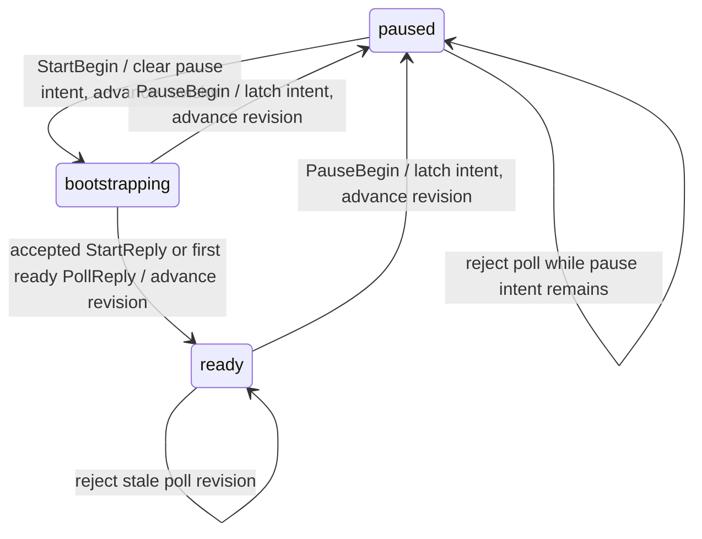

The first accepted ready observation, including a poll before the start reply, invalidates older bootstrap snapshots. Start and pause begin/completion also fence earlier status replies. The pause-intent latch additionally blocks a fresh ready response after a failed pause; revision matching alone cannot protect that case. Transient pause and completion fences are retained in the model, but the persistent latch makes their individual removal redundant for these properties.

The pinned TLC runner and Java 25 checked the following on November 6, 2026:

| Configuration | Observed result |
| --- | --- |
| `TorStatus.cfg` | PASS: 82,529 generated; 19,350 distinct; depth 14; queue empty; all 11 semantic actions fired |
| `TorStatus_NoRevisionGuard.cfg` | `ReadyNeverRegresses` violated: capture bootstrap at revision 1 → start reply publishes ready at revision 2 → old bootstrap reply clears ready contexts |
| `TorStatus_NoPauseIntent.cfg` | `NoReadyAfterPause` violated: pause begins → native pause fails → pause reply completes at revision 3 → fresh revision-3 poll returns native ready and restores contexts |

```sh
node /path/to/tla-model/scripts/tla.mjs check spec/tla/TorStatus --workers 2 --coverage
node /path/to/tla-model/scripts/tla.mjs trace spec/tla/TorStatus --cfg TorStatus_NoRevisionGuard.cfg
node /path/to/tla-model/scripts/tla.mjs trace spec/tla/TorStatus --cfg TorStatus_NoPauseIntent.cfg
```

The model checks status ordering and readiness capability retention. Native generations, repeated starts/resumes, overlapping pause calls, start failures, network reachability, UI rendering, circuit isolation and liveness are outside this bounded model. Implementation tests must drive the same delayed-reply and failed-pause sequences; these results are not an implementation proof.

## Tor connection recovery

`TorConnect.tla` models one lease and at most two Tor stream connection attempts. A failed first attempt can rotate the scope to a fresh isolation context before a single retry. Rotation and retry dispatch are separate steps; pause, cancellation or scope closure can intervene. An external recovery represents another active lease already replacing the original scope client. TLS and HTTP outcomes occur after connection success, and neither failure can return to the connection retry path.

| Model action | Owning file and symbol |
| --- | --- |
| `FirstConnect`, `RetryConnect`, connection outcomes | `src-tauri/src/transport/session.rs`: `Lease::connect_with_recovery`; `wire.rs`: `exchange`, `socket_inner` |
| `RotateScope`, `OtherRecovery` | `src-tauri/src/transport/session.rs`: `Lease::reconnect_client` |
| `StartTLS`, `TLSResult` | `src-tauri/src/transport/wire.rs`: `exchange`, `TlsConnector::connect` |
| `SendHTTP`, `HTTPResult` | `src-tauri/src/transport/wire.rs`: `exchange`, `send_http`, `http` |
| `Pause`, `Cancel`, `CloseScope` | `src-tauri/src/transport/session.rs`: `Inner::{pause,cancel,close_scope}` |

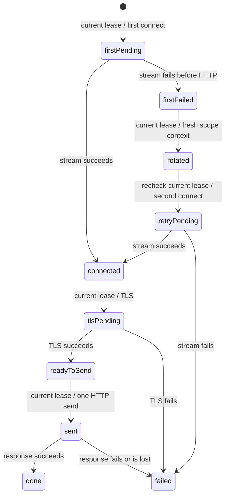

Pinned TLC v1.7.4 checked the base on November 6, 2026: 766 generated states, 240 distinct states, depth 13 and an empty queue. Every semantic action fired. `Terminal` is an artificial stuttering action. The base preserves `NoRetiredReconnect`, `RetryUsesFreshScope`, `NoRequestBeforeConnected` and `AtMostOneHTTPSend`.

| Mutation | Short counterexample |
| --- | --- |
| `TorConnect_NoRetryFence.cfg` | First connect fails → rotate → pause → second connect is dispatched with a retired lease; `NoRetiredReconnect` fails |
| `TorConnect_NoFreshScope.cfg` | First connect fails → rotation retains the original context → second connect uses it; `RetryUsesFreshScope` fails |

Both deliberately weakened configurations exit 12 with their named invariant. Single-send behavior and the TLS-before-HTTP ordering are structural in this model; no artificial replay transition was added merely to manufacture another failing mutation.

This is a bounded authorization and ordering model, not an implementation proof. It abstracts connection failures and timeouts as outcomes, actual Tor circuits and exit selection, DNS, concurrent HTTP operations, storage, TLS correctness and liveness. Context `0` denotes the lease's original client and `1` a replacement, without asserting a different exit address. A retirement blocks a later logical retry dispatch; the model does not claim that previously authorized network work emits no bytes after pause.

## Tor circuit retirement on refusal

`TorRefusal.tla` models one scope answering repeated refusals. A rate limit or block counts the exit address rather than the request, so the scope's isolation context is replaced before the next attempt. Retirement is bounded to once per cooling interval, declines on a retired lease, and does not exist in direct mode. Reading the refusal and acting on it are separate steps, so pause, cancellation, scope closure or another lease's replacement can intervene between them.

The refusal belongs to the context that actually carried the request, which `Recover` separates from the one the lease registered with: a connect retry replaces the scope client before the request goes out, so fencing on the registration context would keep the client that was just refused. `OtherRecovery` is the opposite case — a replacement this request did not make — and must still be declined. `Retire` and `Decline` partition the refusal on exactly the implementation's guard.

| Model action | Owning file and symbol |
| --- | --- |
| `Send`, `Refused`, `Accepted` | `src-tauri/src/transport/wire.rs`: `http_with`, `stream_with` status branches |
| `Recover` | `src-tauri/src/transport/session.rs`: `Lease::connect_with_recovery` recording `Lease::established` |
| `OtherRecovery` | `src-tauri/src/transport/session.rs`: `Lease::reconnect_client` driven by another lease |
| `Retire`, `Decline` | `src-tauri/src/transport/session.rs`: `Lease::retire_circuit` |
| `IntervalElapses` | `src-tauri/src/transport/session.rs`: `STATUS_ROTATE_INTERVAL` against `Scope::rotated` |
| `Pause`, `Cancel`, `CloseScope` | `src-tauri/src/transport/session.rs`: `Inner::{pause,cancel,close_scope}` |

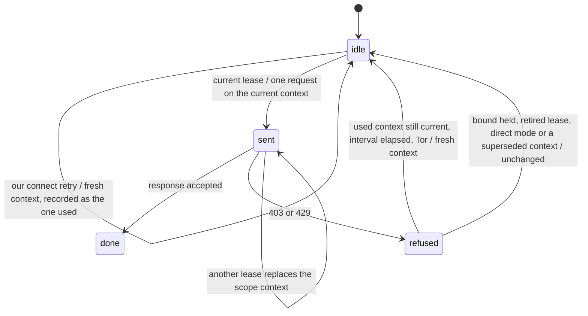

Pinned TLC v1.7.4 checked the base on November 13, 2026: 3,192 generated states, 883 distinct states, depth 14 and an empty queue. Every semantic action fired, including `Recover` (12 new states, 21 firings), `OtherRecovery` (21 new, 160 firings) and `Retire` (7 new, 8 firings). `Terminal` is an artificial stuttering action. The base preserves `RotationsBoundedByInterval`, `NoRetiredRotation`, `NoDirectRotation`, `ContextTracksReplacement` and `NoRetainedRefusedCircuit`.

| Mutation | Short counterexample |
| --- | --- |
| `TorRefusal_NoRotateBound.cfg` | Refusal → retire → refusal → retire inside one interval; `RotationsBoundedByInterval` fails |
| `TorRefusal_NoRotateFence.cfg` | Refusal → pause → retire with a retired lease; `NoRetiredRotation` fails |
| `TorRefusal_NoDirectGuard.cfg` | Direct mode, refusal → retire; `NoDirectRotation` fails |
| `TorRefusal_NoOwnRecovery.cfg` | Our connect retry replaces the context → send → refusal → the registration fence declines and keeps the refused client; `NoRetainedRefusedCircuit` fails |

`TorRefusal_Direct.cfg` runs the unweakened guards in direct mode and stays green with no rotation. The four weakened configurations exit 12 with their named invariant. These six bring `node tools/check-native-model.mjs` to 110 configurations. `src-tauri/src/transport/session.rs` carries the matching implementation tests: `a_refused_status_retires_the_scope_circuit_once_per_interval` for the bound, `a_refused_status_retires_nothing_a_retired_lease_no_longer_owns` for the superseded context, `a_refusal_after_connect_recovery_retires_the_client_that_answered` for the recovered one and `direct_mode_has_no_circuit_to_retire` for the mode.

This is a bounded authorization and bounding model, not an implementation proof. It abstracts the real clock as a cooling flag plus an interval counter, and `scopeContext` counts replacements without asserting that a new isolation token yields a different exit address. It says nothing about whether a fresh circuit is admitted, and it does not model a second scope: retirement never reads or writes another scope's context in the implementation.

## Wallet status heartbeat

`WalletStatus.tla` separates one maintenance tick from a recurring public-status heartbeat. Both callers share a pending read. Private catch-up may remain blocked indefinitely while status responses continue; disposal can intervene before a response or timer rearm.

| Model action | Owning file and symbol |
| --- | --- |
| `StartMaintenance` | `src/shielded/wallet.ts`: `ShieldedWallet.tick`, `refreshPoolStatus` |
| `StartHeartbeat` | `src/shielded/wallet.ts`: `ShieldedWallet.statusTick`, `refreshPoolStatus` |
| `StatusResult` | `src/shielded/wallet.ts`: `ShieldedWallet.refreshPoolStatus` publication fence |
| `ArmHeartbeat` | `src/shielded/wallet.ts`: `ShieldedWallet.statusTick` timer fence |
| `PrivateComplete` | `src/shielded/wallet.ts`: `ShieldedWallet.tick` after `load`/`sync` |
| `Stop` | `src/shielded/wallet.ts`: `ShieldedWallet.dispose` |

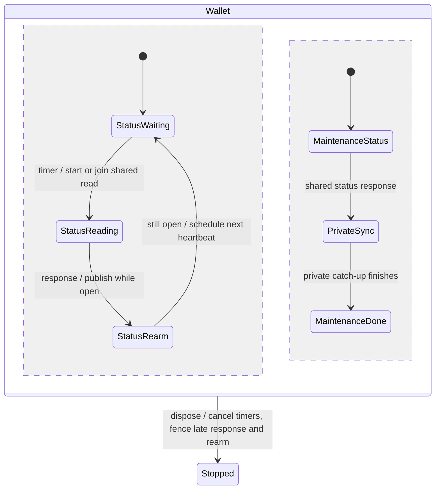

The clock starts at a watchdog deadline; each unit is one refresh interval. This model assumes a responsive public endpoint and a scheduler that processes due public work before the next clock unit. `AdvanceClock` enforces that latency bound, while weak fairness requires enabled status actions to progress. The private sync has no fairness requirement. `PulseProgress` checks that a due heartbeat eventually publishes even when private work never completes; `FreshWhileSyncing` checks that two intervals cannot pass without fresh status under these assumptions. Real Tor delays, failed status reads, head-expiry revision races and financial operations are outside this model.

Pinned TLC v1.7.4 checked the base on November 6, 2026: 731 generated states, 254 distinct states, depth 19, an empty queue and all four temporal branches checked. Every semantic action fired: maintenance start 16, heartbeat start 40, response 110, rearm 16, private completion 77, clock advance 147 and stop 79. `Terminal` is an artificial stuttering action (257 firings). The base preserves one status read, publication and timer shutdown fences, and fresh status during blocked catch-up.

| Mutation | Short counterexample |
| --- | --- |
| `WalletStatus_Coupled.cfg` | Maintenance status succeeds → private sync remains blocked → two clock advances without a heartbeat → `FreshWhileSyncing` fails |
| `WalletStatus_NoSingleFlight.cfg` | Maintenance starts a read → heartbeat starts another before its response → `OneStatusRead` fails |
| `WalletStatus_NoPublishFence.cfg` | Start read → stop → response publishes → `NoStatusAfterStop` fails |
| `WalletStatus_NoTimerFence.cfg` | Heartbeat response → stop → rearm → `NoTimerAfterStop` fails |

All four mutations exit 12 with their named invariant. Their shortest traces are retained with the external native QA artifacts. The first shutdown mutations exposed an unparenthesized boolean assignment in the model; it was corrected before the recorded checks. The wider `WalletStatus_Sim.cfg` passed 20,000 traces at depth 100 with seed 20261106 and 2,081,629 states checked. It uses six clock intervals; random simulation supplements the exhaustive base and does not prove wider liveness.

## Native wallet view handoff

`NativeViewHandoff.tla` separates an already-mounted wallet from a replacement candidate and its operational owner. Suspend, failed startup and repeated resume retire operations while retaining the old render as inert. Provider creation waits for every previous owner to dispose and a native generation newer than the previous owner's. A candidate replaces the shown wallet only after both pool and private-wallet readiness, with current generation, candidate identity, visibility and lock checks. Lock immediately revokes the candidate and hides both views. `FinishLock` models clearing the abstract retained secret after successful operational disposal; it does not model the source's behavior when cleanup rejects.

The source has a different cache-clearing policy on failure: `NativeWallet.pause` calls `previous?.cache.clearMemory()` in the `finally` of an aggregate promise. It clears on rejection as well as fulfillment, and the aggregate may reject before all other tasks settle. `createNativeCleanup` retains failed tasks, and `NativeWallet.open` drains them before creating new providers. The model checks the ownership handoff and its successful cleanup path; `LockClearsAfterCleanup` does not certify the actual cache-clearing order on failed cleanup. That source policy is unchanged by this handoff change.

| Model action | Owning file and symbol |
| --- | --- |
| `Hide`, `Foreground`, `StartNative` | `app/src/NativeWallet.tsx`: visibility handler and `open` |
| `Retire`, `BeginCandidate` | `app/src/native-view-handoff.ts`: `createNativeViewHandoff` / `retire`, `discard`, `stage`; `NativeWallet.tsx`: cleanup before `open` |
| `Dispose`, `Unmount` | `app/src/native-view-handoff.ts`: per-view `onShutdown` ownership; `app/src/RollupWallet.tsx`: shutdown and unmount callbacks |
| `PoolReady`, `WalletReady`, `CaptureReady`, `DeliverReady` | `app/src/RollupWallet.tsx`: `onReady`; `app/src/native-view-handoff.ts`: `promote`; `NativeWallet.tsx`: readiness guard |
| `LockIntent` | `app/src/NativeWallet.tsx`: lock callback and immediate view retirement |
| `FinishLock` | Successful-cleanup abstraction only; `NativeWallet.pause` has the different rejection policy described above |

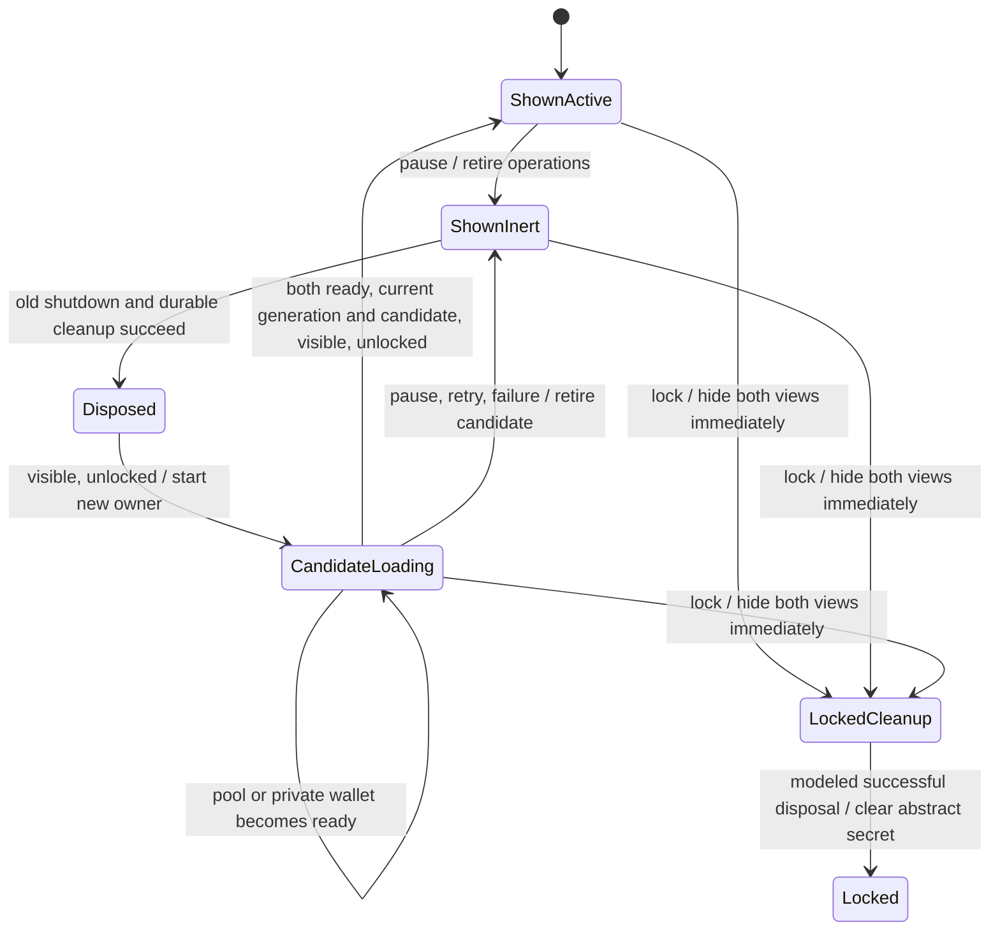

Two callback actors race at most three operational owners and three native generations in the exhaustive base. Callback capture and delivery are separate steps. Native generation changes, visibility changes, late readiness, candidate retirement and old unmount callbacks can intervene independently. `retained` and `bad` are history variables for view continuity and activation authorization. `DropReady` and `Terminal` represent discarded callbacks and stuttering. All semantic actions fired, including 4,760 callback drops; a zero count of newly discovered states for that action does not mean it was disabled.

Pinned TLC v1.7.4 checked the base on November 8, 2026: 29,415 generated states, 3,837 distinct states, depth 21 and an empty queue. The eight guard mutations each exit 12 with the named invariant:

| Configuration | Shortest counterexample |
| --- | --- |
| `NativeViewHandoff_NoGeneration.cfg` | Stage candidate → native generation advances → old generation promotes; `NoStaleGeneration` fails (10 states) |
| `NativeViewHandoff_NoVisibility.cfg` | Stage candidate → hide → readiness promotes; `NoHiddenActivation` fails (10 states) |
| `NativeViewHandoff_NoLock.cfg` | Lock → dispose → admit candidate while locked → readiness promotes; `NoLockedActivation` fails (9 states) |
| `NativeViewHandoff_NoCandidate.cfg` | Stage → retire candidate → old readiness promotes; `OnlyCurrentCandidate` fails (10 states) |
| `NativeViewHandoff_NoReadiness.cfg` | Stage → callback promotes before either readiness result; `ReadyBeforePromotion` fails (7 states) |
| `NativeViewHandoff_NoDisposal.cfg` | Start native generation → stage new owner before old disposal; `DisposeBeforeNewOwner` fails (3 states) |
| `NativeViewHandoff_NoShutdownOwner.cfg` | Dispose old owner → stage new owner → old unmount clears new shutdown handle; `ShutdownOwnerPreserved` fails (6 states) |
| `NativeViewHandoff_NoRetainedView.cfg` | Pause drops the old view; `RetainUntilReady` fails (2 states) |

The lock mutation removes the unlocked guard from both candidate admission and promotion; immediate candidate revocation also fences previously captured callbacks. The wider configuration passed 20,000 traces at depth 100 with four actors, five owners, five generations and seed 20261108: 2,005,317 states checked. The native CI gate now matches 27 expected configurations, compared with the 18-configuration baseline.

This is a bounded ownership and view-continuity model. It abstracts React rendering and inert behavior, provider internals, actual pool and wallet readiness, transport failure details, vault durability and financial protocols. First unlock, onboarding, mode-switch teardown and cache clearing after rejected cleanup are outside its scope. Disposal is an acknowledged success, so an owner whose cleanup has not succeeded continues to block a new owner. No fairness or recovery liveness is claimed. The action anchors identify related source; they are not a checked refinement mapping. These results do not prove the implementation, secret zeroization or physical-device behavior.

## Eager native Tor startup

`TorStartup.tla` models reserving the initial Tor startup synchronously before the WebView loads, then running its worker alongside frontend initialization. Same-mode frontend calls join the reserved job; they cannot return an intermediate `bootstrapping` result. Bootstrap work belongs to the native host, so cancelling one caller does not cancel work awaited by another.

`prewarm` is the non-blocking kickoff and intentionally returns an immediate status snapshot. The terminal-waiting contract applies to asynchronous `start` and `start_mode`. The `initial_only` check inside `Inner::prepare_start` limits host kickoff to the initial locked, generation-zero Tor state; calling it again cannot reverse pause or a direct-mode choice.

Reservation captures generation, mode and intent. Pause and fresh mode/retry requests invalidate the previous intent, notify its waiters immediately, and cancel old work. New network work waits for retirement acknowledgements. A queued worker checks its reservation before starting; a completed worker checks it again before changing session state. Terminal completion is retained through a first-write CAS, including with no waiting callers, and a late waiter rechecks generation and mode before returning readiness. Owner drop also signals completion. These are abstract contracts, not a checked source refinement.

| Model action | Owning file and symbol |
| --- | --- |
| `SetupReserve`, `ShowWebview` | `src-tauri/src/lib.rs`: `run`; `src-tauri/src/transport/mod.rs`: `PrivacyTransport::prewarm`; `session.rs`: `Inner::prewarm`, `Inner::prepare_start` |
| `RequestStart`, `Read`, `Bind`, `Observe` | `session.rs`: `Inner::prepare_start`, `PreparedStart`, `Startup::waiter`, `StartWaiter::wait` |
| `WorkerBegin`, `DrainAck` | `session.rs`: `StartupWork::run_with_bootstrap`, its retirement loop, `Inner::check_start`, `Session::start_matches` |
| `Capture`, `Commit` | `session.rs`: `StartupWork::run`, `StartupWork::run_with_bootstrap`, `Inner::finish_start`, `Session::start_matches` |
| `Complete`, `Pause` | `session.rs`: `Startup::finish`, `Session::invalidate` |
| `AbortQueued`, `OwnerAbort` | `session.rs`: `StartupWork::run_with_bootstrap` cancellation/check branches, `StartupWork::drop` |
| `CancelCaller` | `session.rs`: `Inner::start_with_drain_timeout` detaches the worker before `StartWaiter::wait`; dropping the receiver does not own that task |

```mermaid
stateDiagram-v2
    [*] --> Reserved: native setup reserves generation synchronously
    state Reserved {
        [*] --> QueuedWorker
        QueuedWorker --> Connecting: current reservation and prior resources drained
        Connecting --> TerminalResult: ready or error
        QueuedWorker --> TerminalResult: owner abort
        Connecting --> TerminalResult: owner abort
        --
        [*] --> LoadingFrontend
        LoadingFrontend --> Joining: frontend asks for same-mode startup
        Joining --> Returned: terminal result retained and generation/mode current
        Joining --> CallerCancelled: caller abandons only its wait
    }
    Reserved --> Paused: invalidate and notify immediately; cancel owner
    Paused --> Draining: fresh explicit start or mode switch
    Draining --> Reserved: reserve next generation; worker awaits retirement
```

The exhaustive base has two callers, two startup jobs and three generations, covering a failed attempt followed by one retry. Worker result capture and publication are separate. An intent epoch distinguishes a new user request from a queued host request retired by pause or a mode choice. `oldResources` abstracts all cancellation/stop acknowledgements; it does not mean a retained dormant Arti client is destroyed on ordinary pause.

In the source, `StartWaiter::wait` explicitly rechecks generation and mode after reading the retained result. The model's additional ready-phase predicate is a derived correspondence condition: startup phase writers are fenced by `Session::start_matches`, and the other exits from ready invalidate generation first. A retained ready result therefore cannot become non-ready with the same generation and mode. Non-ready terminal statuses are failures for readiness. The already-ready fast path is linearized inside `Inner::prepare_start`'s session lock rather than awaiting a completion. The model does not cover later IPC delivery, JavaScript revision/visibility checks or actual vault access, and is not composed with the other models into a refinement proof.

Pinned TLC v1.7.4 checked the base on November 8, 2026: 131,128 generated states, 27,210 distinct states, depth 19 and an empty queue. Every semantic action fired. `ReserveLate` and `DuplicateStart` are mutation-only actions and correctly have zero base coverage. `Terminal` is artificial stuttering. All ten guard mutations exit 12 with their named invariant; their single-worker counterexamples are:

| Configuration | Counterexample |
| --- | --- |
| `TorStartup_NoReservation.cfg` | Queue host request without reservation → pause → drain → late reservation → worker starts retired intent; `NoRetiredIntentStart` fails (6 states) |
| `TorStartup_NoSingleFlight.cfg` | Reserve initial startup → duplicate same-generation owner; `OneBootstrapPerGeneration` fails (3 states) |
| `TorStartup_NoStartFence.cfg` | Reserve → pause → drain → queued worker starts anyway; `NoRetiredIntentStart` fails (5 states) |
| `TorStartup_NoCompletionFence.cfg` | Reserve → pause → queued abort → old completion changes current phase; `NoStaleCompletion` fails (5 states) |
| `TorStartup_NoReplyFence.cfg` | Startup succeeds → caller captures result → pause → late join returns stale ready; `NoStaleReadyReply` fails (10 states) |
| `TorStartup_NoReadiness.cfg` | Frontend binds before completion and returns `bootstrapping`; `TerminalBeforeReply` fails (5 states) |
| `TorStartup_NoDrain.cfg` | Reserve → mode switch → new worker starts before old retirement; `DrainBeforeBootstrap` fails (5 states) |
| `TorStartup_NoNotification.cfg` | Reserve → pause loses completion notification; `CompletionAlwaysSignals` fails (3 states) |
| `TorStartup_NoCallerOwnership.cfg` | Caller captures startup → cancellation aborts native-owned work; `CallerDoesNotOwnBootstrap` fails (5 states) |
| `TorStartup_NoTerminalCas.cfg` | Worker starts → pause publishes abort → late ready overwrites terminal result; `TerminalResultRetained` fails (6 states) |

`TerminalJoinersRelease` is conditional liveness: once completion is retained, an attached waiter eventually returns or cancels under weak fairness of its observation step. No fairness is imposed on network completion, worker scheduling or retirement acknowledgements, so the model does not promise bootstrap/retry latency or eventual connectivity. Caller delivery before the native reservation boundary and process restart are outside its scope.

The wider configuration passed 20,000 traces at depth 100 with four callers, four jobs, five generations and seed 20261108, checking 2,040,179 states. The native gate includes 38 expected configurations, up from 27. Local checks used two workers and a 256 MiB heap because of host memory pressure. These results do not prove Tor directory validation, circuit isolation, caching, cryptography, native vault durability, frontend rendering, physical-device behavior or a startup speedup.

## Scoped native HTTP reuse

`HttpReuse.tla` models HTTP/1 keepalive inside a native isolation scope. The session owns at most one idle socket per scope, additionally matched by origin and Arti context. A request removes the cached socket before awaiting readiness, then owns it exclusively through dispatch and complete body consumption. Only a validated complete response can return it to the cache. A stale socket can be replaced before dispatch; a failure after dispatch never retries the request.

Each return assigns a unique cache-entry identity. An idle-expiry callback checks generation, scope and that identity before removing a slot. Scope closure, context rotation and session retirement drop cached sockets. Their native stream retirement remains pending until the driver closes; a replacement session waits for that drain. A lease that recovered with a newer Arti context than its captured context does not repopulate the cache.

| Model actions | Owning file and symbols |
| --- | --- |
| `Register`, `Checkout` | `src-tauri/src/transport/session.rs`: `Inner::register`, `Lease::take_http` |
| `Open`, `ConnectResult`, `Recover` | `session.rs`: `Lease::connect`, `Lease::connect_with_recovery`, `Lease::reconnect_client` |
| `ReplaceClosed`, `Dispatch`, `Response` | `src-tauri/src/transport/wire.rs`: `HttpConnection::new`, `HttpConnection::ready`, `HttpConnection::send`, `http` |
| `Return` | `session.rs`: `Lease::return_http`; `wire.rs`: `http` returns only after bounded body collection |
| `Expire`, `Evict` | `session.rs`: `Inner::expire_http`, `Lease::return_http` |
| `Cancel`, `Drop`, `Fail`, `CloseScope` | `session.rs`: `Inner::cancel`, `Inner::close_scope`, `Lease::drop`; `wire.rs`: cancellation, timeout and response-error paths |
| `Rotate` | `session.rs`: `Lease::reconnect_client` |
| `Pause`, `Drain`, `Resume` | `session.rs`: `Session::invalidate`, `Retirement::drop`, `StartupWork::run_with_bootstrap` |

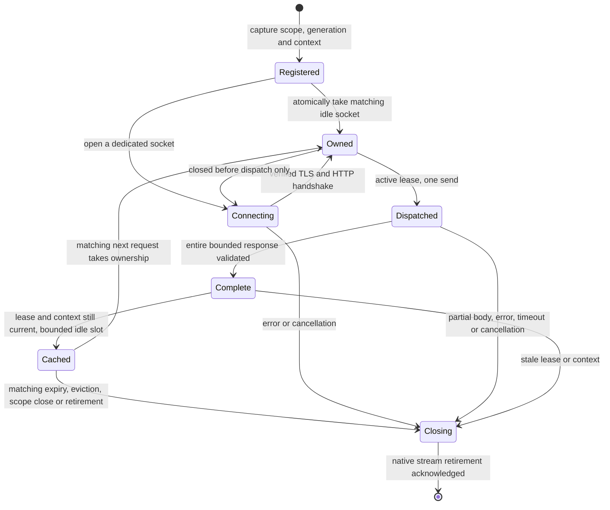

The exhaustive base uses two workers, two scopes, two origins, one request per worker, one session-generation advance and one context advance per scope. Its idle cap is reduced to one to force overflow with two scopes; this is a bounded abstraction of the production cap of sixteen. Recovery after another request has already advanced the context may join that current context; a second advance beyond the model's one-rotation bound is outside this configuration. Successful body collection and native resource retirement are abstract acknowledgements, not assumptions that an interrupted request succeeded.

Pinned TLC v1.7.4 checked the base on November 11, 2026 with two workers and a 2 GiB JVM heap: 19,900,857 generated states, 3,750,692 distinct states, depth 26 and an empty queue. Every semantic action fired except `Resend`, which is intentionally mutation-only. All twelve guard mutations exit 12 with their intended invariant:

| Configuration | Observed counterexample |
| --- | --- |
| `HttpReuse_NoCheckoutFence.cfg` | A cancelled lease takes an idle connection; `NoRetiredCheckout` fails |
| `HttpReuse_NoScope.cfg` | A request takes another scope's connection; `NoCrossScopeUse` fails |
| `HttpReuse_NoOrigin.cfg` | A request takes a socket for another origin; `NoCrossOriginUse` fails |
| `HttpReuse_NoCheckoutContext.cfg` | An old lease takes a new-context socket after rotation; `NoRetiredContextCheckout` fails |
| `HttpReuse_NoExclusive.cfg` | Checkout leaves the same socket cached and owned by a request; `ExclusiveOwnership` fails |
| `HttpReuse_NoReturnFence.cfg` | Cancellation between body completion and return repopulates the cache; `NoRetiredReturn` fails |
| `HttpReuse_NoReturnContext.cfg` | Context rotation between completion and return repopulates an old-context slot; `NoRetiredContextReturn` fails |
| `HttpReuse_NoComplete.cfg` | The request is cached before its body completes; `OnlyCompleteBodiesCached` fails |
| `HttpReuse_NoBound.cfg` | Two scopes fill an idle pool whose bound is one; `BoundedIdle` fails |
| `HttpReuse_NoExpiryFence.cfg` | The first return's timer removes the second return's replacement slot; `NoStaleExpiry` fails |
| `HttpReuse_Resend.cfg` | A failed post-dispatch request is sent again; `AtMostOneSend` fails |
| `HttpReuse_NoDrain.cfg` | A new session becomes ready while the old stream is still live; `DrainBeforeResume` fails |

The CI checker includes all thirteen exhaustive configurations, bringing the complete native gate to 51 expected configurations without removing any previous coverage. The wider configuration passed with four workers, the same two scopes and origins, 20,000 random traces at depth 100 and seed 20261111: 2,000,001 states checked.

The model abstracts DNS, TLS internals, actual body bytes, HTTP parsing, cache-age wall time, server keepalive policy and scheduler behavior. It treats checkout, cache return, expiry comparison and session invalidation as the corresponding session-lock atomic steps. It provides no fairness, latency, termination, cryptographic-isolation or physical-device proof, and the source-symbol anchors are not a checked refinement mapping. SSE and WebSockets remain outside this HTTP reuse model and retain dedicated connections.

## Android in-app updates

`AndroidUpdate.tla` separates the update controller, native download completion and Android installer callback. The controller reserves one update owner before awaiting network work. A download captures its session generation, over Tor or a direct connection; cancellation and pause can happen between byte completion, verification and publication. Only complete bytes with the advertised hash, the same application and signing certificate, and a strictly newer Android version may become prepared. The native download asks the host mirror first and falls back to the pinned GitHub release under the same integrity checks; the model abstracts HTTP and redirects, so neither source appears in it. A prepared file can remain ready while the session changes.

Installation requires a fresh explicit action. Returning from Android's unknown-source permission settings returns to ready and consumes the earlier action. The native installer rechecks the prepared archive and retains exclusive ownership while copying its bytes into a package-install session. One attempt can commit that session once. A pending-user-action callback is not success; a lost callback becomes unknown and must be reconciled before another attempt. A bounded process crash discards unsubmitted staging and preserves the identity of an already committed attempt. None of these actions changes wallet storage.

| Model actions | Owning file and symbol boundary |
| --- | --- |
| `Begin`, `Cancel`, `Retire` | `src-tauri/src/android_updates.rs`: `AndroidUpdates::reserve`, `AndroidUpdates::cancel`, `DownloadOwner::drop` |
| `Receive`, `Publish` | `src-tauri/src/transport/update.rs`: `PrivacyTransport::download_update`, `PrivacyTransport::finish_update`; `android_updates.rs`: `DownloadOwner::publish` |
| `Verify`, `BeginInstall` | `android_updates.rs`: `check_installation`, `check_candidate`, `AndroidUpdates::begin_install`; `AndroidUpdater.kt`: `verify` |
| `Click`, `NeedPermission`, `PermissionReturn` | `app/src/android-updates.ts`: `createAndroidUpdateController` methods `install`, `permission`, `visibilityChanged`; `AndroidUpdater.kt`: `permission` |
| `Submit`, `Reply`, `UserDecision`, `Reconcile` | `src-tauri/plugins/shielded-platform/android/src/main/java/io/arkade/shielded/platform/AndroidUpdater.kt`: `install`, `receive`, `reconcile` and Android `PackageInstaller`; `android_updates.rs`: `InstallOwner::finish` |
| `Invalidate`, `Resume`, `Crash` | transport generation/cancellation; `AndroidUpdates::new`; `AndroidUpdater.reconcile` |

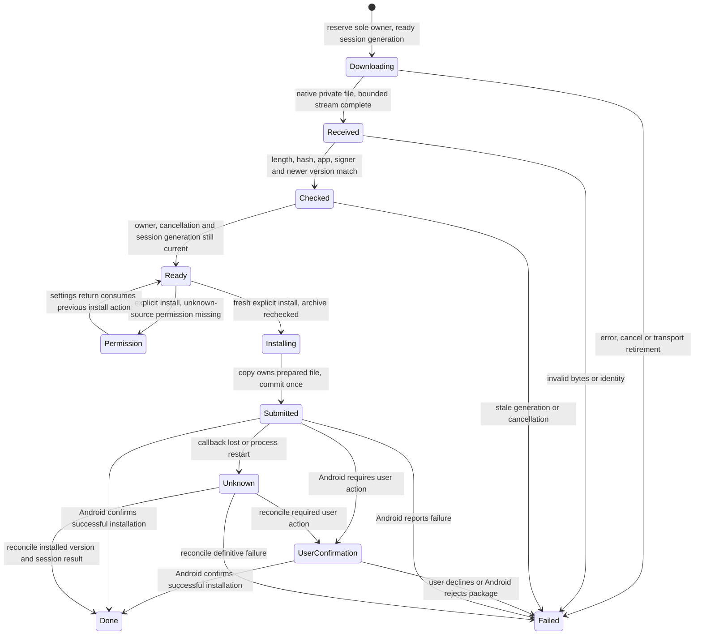

Pinned TLC v1.7.4 checked the exhaustive base on November 12, 2026, after updates were allowed over a direct connection: 557,057 generated states, 238,140 distinct states, depth 28 and an empty queue. Every semantic action fired. The base bounds two update attempts, two transport-generation advances and one process crash. All thirteen individual guard mutations exit 12 with the named invariant:

| Configuration | Counterexample condition |
| --- | --- |
| `AndroidUpdate_NoOwner.cfg` | two update downloads overlap; `OneDownloader` fails |
| `AndroidUpdate_NoTransport.cfg` | an update starts while the session is paused; `ReadyTransportOnly` fails |
| `AndroidUpdate_NoFence.cfg` | a cancelled or retired completion becomes ready; `FreshPublication` fails |
| `AndroidUpdate_NoLength.cfg` | truncated bytes become ready; `CompleteBytes` fails |
| `AndroidUpdate_NoHash.cfg` | bytes with the wrong digest become ready; `MatchingHash` fails |
| `AndroidUpdate_NoCertificate.cfg` | another signer's APK becomes ready; `MatchingCertificate` fails |
| `AndroidUpdate_NoPackage.cfg` | another application's APK becomes ready; `MatchingPackage` fails |
| `AndroidUpdate_NoVersion.cfg` | an equal or older version becomes ready; `NewerVersion` fails |
| `AndroidUpdate_NoRecheck.cfg` | an archive changed after preparation reaches installation; `RecheckedInstall` fails |
| `AndroidUpdate_NoConsent.cfg` | settings return automatically resumes installation; `ExplicitInstall` fails |
| `AndroidUpdate_NoFileLease.cfg` | cancellation deletes the file while the installer copies it; `PreparedFileLeased` fails |
| `AndroidUpdate_NoCommitOnce.cfg` | a repeated call commits the same attempt twice; `OneInstallerCommit` fails |
| `AndroidUpdate_NoPending.cfg` | pending user confirmation is reported as installed; `PendingRequiresUser` fails |

The CI checker includes these fourteen configurations, increasing its gate from 51 to 65 without dropping previous coverage. Wider simulation passed 20,000 traces at depth 100 with four attempts, three generation advances and two crashes; after the direct-connection change it checked 458,911 states with no violation.

The model abstracts actual HTTP/TLS and redirect parsing, digest/signature algorithms, Android package parsing, file-system durability, permission UI and the installer service. It assumes the native verification results accurately describe the bytes. It checks bounded safety, not eventual connectivity, download speed, store eligibility, on-device installation or preservation of a particular device's wallet data. The source boundaries above are review anchors, not a checked refinement mapping.

## Android update recovery

`UpdateRecovery.tla` checks reconciliation around an existing update receipt. Version A is installed, the app owns a prepared version B, and metadata may advertise C while B is still pending. The UI and native file owner interpret an older `installed` receipt independently. Neither may declare B complete or remove its prepared file until the actual installed version reaches B. Completing owned B releases its pending fence and exposes C as available.

An offered Android-settings action must work for both ready and retryable failed updates. Each installation attempt still requires a fresh explicit action. Precommit failures return a definitive failed receipt; a volatile journal keeps that outcome authoritative for later status reads if preferences cannot persist it. A possible postcommit failure retains uncertainty and cannot start another installation.

The authorization worker posts a queued main-thread action and waits. Timeout or interruption cancels a queued action atomically, preventing a late handler from executing it. Once the handler is running, timeout is ambiguous: its current-attempt journal and ownership remain until Android provides a definitive result. Lost confirmation cannot release that fence when abandoning the old session fails or the session still exists. Installer ownership also carries an attempt identity, so a delayed owner from a failed attempt cannot change a replacement attempt's `calling` flag.

Cache eviction can remove an APK before installation. A later native snapshot or install check reports a known failure without a prepared stage, allowing a fresh download. It does not release a call in progress or a pending Android session that already owns copied bytes. Version-qualified installation success takes precedence over an absent cache file.

A native info query captures the coordinator ticket before awaiting Android. Its reply may mutate only the same phase, prepared-stage incarnation, attempt and `calling` state. A reply captured before a later install, or before a call changes from active to returned, cannot unlock that newer owner even when JavaScript discards its own stale reply.

The API's `staged.ready` marker projects that fenced native Ready state. Recovering an unknown UI presentation through this marker still requires a valid future target; native busy status wins, and installing requires a new explicit action. The model checks installation eligibility, not eventual UI recovery.

| Model actions | Source anchors |
| --- | --- |
| `AdvanceLatest`, `UIReconcile`, `ClickSettings`, `ReturnSettings`, `Deliver` | `app/src/android-updates.ts`: `createAndroidUpdateController`, its `reconcile`, `setRelease`, `permission`, `install` and `visibilityChanged` paths |
| `HostSnapshot`, `RejectMissingFile`, `Claim`, `DropOwner` | `src-tauri/src/android_updates.rs`: `AndroidUpdates::snapshot_for`, `AndroidUpdates::begin_install`, `InstallOwner::finish`, `InstallOwner::drop` |
| `ReadInfo`, `ReplyInfo` | `android_updates.rs`: `native_android_update_info`, `AndroidUpdates::query_info`, `AndroidUpdates::info_ticket`, `AndroidUpdates::snapshot_for`, `InfoQueryTicket`; fenced `staged.ready` projection |
| `PrepareRecord`, `PrecommitFailure`, `QueueAuthorization`, `Commit` | `AndroidUpdater.kt`: `install`, `info`; `AndroidUpdatePolicy.kt`: `AndroidUpdateJournal::read`, `AndroidUpdateJournal::write`, `mayHaveCommitted` |
| `RunAuthorization`, `AuthorizationTimeout` | `AndroidUpdateAuthorization.kt`: `AndroidUpdateAuthorization::run`, `AmbiguousUpdateAuthorization` |
| `TryAbandon`, `OSComplete`, `OSFailure` | `AndroidUpdater.kt`: `confirm`, `receive`, `reconcile`; `AndroidUpdatePolicy.kt`: `afterAbandon` |
| `CacheEvict` | External cache removal; native file checks before reconciliation or installation |

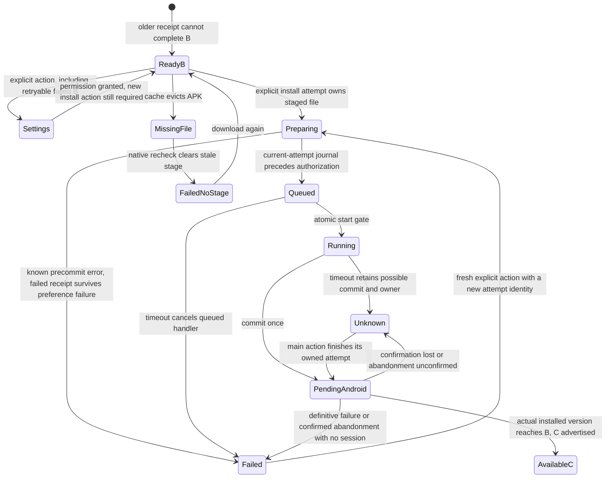

Pinned TLC v1.7.4 checked the base on November 11, 2026 with two workers and a 512 MiB heap: 3,131,642 generated states, 632,544 distinct states, depth 30 and an empty queue. Every semantic action fired. The base bounds two explicit installation attempts, two stage incarnations and one captured info query, begun before or during the first attempt; `UpdateRecovery_Sim.cfg` widens installation attempts to four. Eight individual guard mutations fail their intended invariant:

| Configuration | Counterexample |
| --- | --- |
| `UpdateRecovery_NoVersionGuard.cfg` | an older success completes B or removes its file; `NoStaleInstalledCompletion` fails |
| `UpdateRecovery_NoPermissionRetry.cfg` | the settings button offered for failed B is ignored; `NoIgnoredPermissionAction` fails |
| `UpdateRecovery_NoKnownFailure.cfg` | precommit rejection plus stale persisted state leaves reconciliation unknown; `NoStrandedKnownFailure` fails |
| `UpdateRecovery_NoAuthFence.cfg` | a cancelled queued handler starts later; `NoCancelledAuthorization` fails |
| `UpdateRecovery_NoMissingFile.cfg` | native reconciliation keeps an evicted APK ready; `NoReadyMissingFile` fails |
| `UpdateRecovery_NoAbandonFence.cfg` | failed or unconfirmed abandonment permits another attempt while the old session is unresolved; `NoRetryWithUnresolvedSession` fails |
| `UpdateRecovery_NoAttemptFence.cfg` | an old owner's drop changes a replacement call; `NoRetiredOwnerChangesNewAttempt` fails |
| `UpdateRecovery_NoInfoFence.cfg` | a retired query reply mutates a newer coordinator phase, stage or attempt; `NoStaleInfoMutation` fails |

The checker retains all 65 earlier configurations and adds these nine, for 74 expected configurations. Wider simulation passed 20,000 traces at depth 100 with four attempts and seed 20261111, checking 2,000,024 states. C is advertised metadata in this model; installing C is outside its boundary.

The model abstracts package bytes, disk and preference APIs, Android process/service internals, actual file checks and wall-clock time. Cache inspection and subsequent state publication represent the native guarded transition, not unguarded file IO under a mutex. A missing file is reported after observation rather than treated as immediately known to every actor. No fairness, eventual recovery, physical-device behavior or checked refinement relationship is claimed.

## Terminal receipts and operation dispatch

`UpdateRecoveryReceipts.tla` isolates two callback/bridge boundaries without multiplying the larger query model's states. A terminal Android callback can arrive before a possible-commit error reaches the install catch. If its token, session and target match this attempt, the catch preserves the exact installed/failed status and error in both the journal and its response. An older attempt's terminal record cannot replace the current attempt's failure.

The plugin dispatch gate distinguishes Queued, Started and Cancelled. A failed install request is definitively retryable only after cancellation wins before dispatch. Started failures retain generic error semantics because the operation might have run. Confirm and read-only requests keep generic errors even when dispatch never starts. Two failure callers classify and publish separately: the caller that cancelled the queue can lose the response race, so the other caller must classify the stable Cancelled state rather than its own failed compare-and-set. Cancelled work never starts later, and a response already claimed cannot be overwritten.

| Model actions | Source anchors |
| --- | --- |
| `ReceiveTerminal`, `Recover` | `AndroidUpdater.kt`: `receive`, `install` catch under the shared lock; `AndroidUpdatePolicy.kt`: `terminalResult` |
| `ClassifyFailure`, `PublishFailure`, `BeginOperation`, `CompleteOperation` | `AndroidUpdateDispatch.kt`: `fail`, `begin`, `complete`; `ShieldedPlatformPlugin.kt`: `update`, install-only `updateInstall` |
| `Deliver` | `src-tauri/src/android_updates.rs`: `InstallOwner::finish` accepts a definitive failed install result |

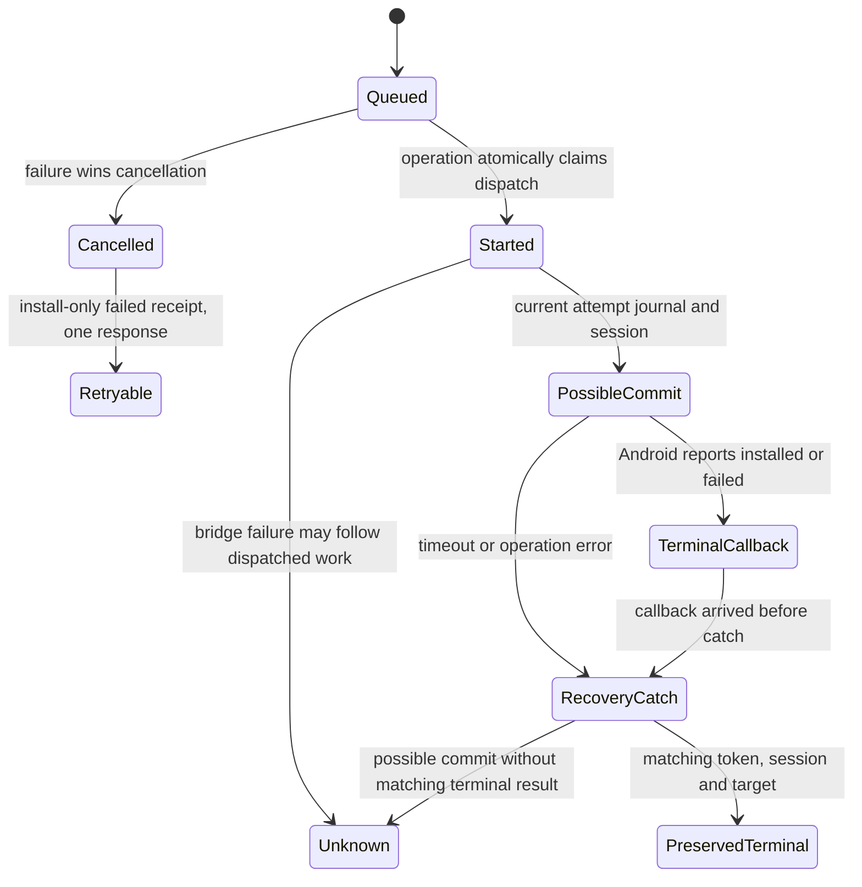

Pinned TLC v1.7.4 checked the base on November 11, 2026 with two workers and a 512 MiB heap: 1,044 generated states, 468 distinct states, depth 12 and an empty queue. Every semantic action fired. Three separate guard mutations fail their intended invariant:

| Configuration | Counterexample |
| --- | --- |
| `UpdateRecoveryReceipts_NoTerminalReceipt.cfg` | callback saves a matching terminal result, then generic catch recovery overwrites it; `TerminalReceiptRetained` fails |
| `UpdateRecoveryReceipts_NoCancelledReceipt.cfg` | the first failure cancels Queued but the second failure wins the response and uses its lost compare-and-set to reject a definitely unstarted install; `DefiniteInstallRejectionRetryable` fails |
| `UpdateRecoveryReceipts_NoDispatchFence.cfg` | a classified cancelled request starts its operation later; `NoCancelledDispatch` fails |

Wider simulation passed 20,000 traces at depth 100 with four opaque failure codes instead of two, seed 20261111, checking 99,048 states. The checker retains the earlier 74 configurations and adds this base plus three mutants, for 78 expected configurations.

The model has one operation and two failure callers, abstracts bridge and Android APIs, and assumes an available prepared file and accurate journal reads under the shared lock. It preserves opaque callback errors by equality rather than interpreting them. The broader recovery model owns file loss, subsequent status queries and explicit retry attempts. No eventual delivery, successful Android installation, cryptographic correctness or checked source refinement is claimed.

## Warm Tor and a passive resume view

`NativeWarmView.tla` permanently revokes the operation-owner generation on every native suspension or frontend hide. Since soft background continuity, this hard path covers hides before Ready and renderer-initiated pauses; `NativeContinuity.tla` owns an ordinary background of a Ready session. Old SDK graphs, providers, streams and callback continuations remain bound to that revoked generation. Returning creates a fresh graph after the cleanup/drain and full-readiness barriers. `FirstFetch` deliberately occurs separately from operation start: an old proof/signing continuation cannot borrow a current generation for its first POST after resume.

Only a bounded frozen display projection and a local scanner intent may remain for a brief return. The display contains primitive balance/activity strings, with no SDK references, actions, key material or recovery phrase. Lock, reset, mode change, destruction, observed expiry and expired-return projection clear this presentation. Publishing the fresh wallet replaces the passive display. Scanner intent never authorizes a financial operation or revives an old graph.

An already-ready Tor client may remain Normal for a fixed short grace while native request phase is paused. Duplicate pause notifications do not move that original monotonic deadline. A fresh native start consumes the warmth; native Resumed only changes foreground state and emits its event, while JavaScript separately requests a fresh open. Both visibility signals still gate readiness/publication; an existing Ready generation's dispatch is no longer visibility-gated. Client readiness is checked again before Ready even when the same Arti instance remains warm.

Expiry capture and application are separate. Applying Soft dormancy must recheck the captured client/sequence ticket, paused phase and visibility, and serialize its effect against fresh startup's Normal transition. An old queued expiry cannot Soft-dormant a newer foreground client or clear a later warmth/presentation. Full pause/lock/mode/destruction use immediate Soft dormancy and invalidate the warmth ticket. Tor protocol maintenance while Normal is outside private application I/O.

`NativeWarmViewStatus.tla` isolates event/poll ordering. A poll captures its generation, revision, foreground flag and phase before delivery. Native suspension revokes generation; Resumed changes foreground state without making the request phase Ready. A same-generation older poll cannot undo that newer event, so a generation check alone is insufficient for this ordering case.

| Model actions | Source ownership |
| --- | --- |
| `Hide`, `HardStop`, `BeginFresh`, `ConfirmReady` | `src-tauri/src/transport/session.rs`: `Inner::suspend`, `pause`, `prepare_start`, `StartupWork::run_with_bootstrap` and `finish_start`; existing invalidation/drain barrier |
| `NativeResume`, `ShowJS` | `src-tauri/src/lib.rs` emits an actual native foreground transition; `Inner::resumed` only sets visibility; `app/src/NativeWallet.tsx` separately guards visibility and fresh open |
| `WantScanner`, `PublishWallet`, `ConsumeScanner`, `DropPresentation` | `app/src/native-resume-presentation.ts`: copied primitive projection, fixed expiry and scanner delivery; `NativeWallet.tsx` guards callbacks by fresh session/view; `RollupWallet.tsx` opens scanning only when promoted, ready and visible |
| `ReadExpiry`, `ApplyExpiry` | `WarmPause` carries client, opaque ticket and monotonic deadline; `Inner::suspend` schedules a weak timer; `expire_warm` serializes the final client/ticket/phase/visibility check and dormancy transition with startup |
| `BeginOperation`, `FirstFetch`, `Dispatch`, `Deliver` | `src/native/transport.ts`: `NativeBridge.sessionGuard` and `bindFetch` retain the immutable owner before awaits; existing provider/session closures and native generation fences reject retired work |
| Status `Suspend`, `Resumed`, `ReadPoll`, `DeliverPoll` | `NativeBridge.acceptLifecycle` increments `statusRevision` before accepting the event; `status` rejects older polls; the native foreground flag gates startup |

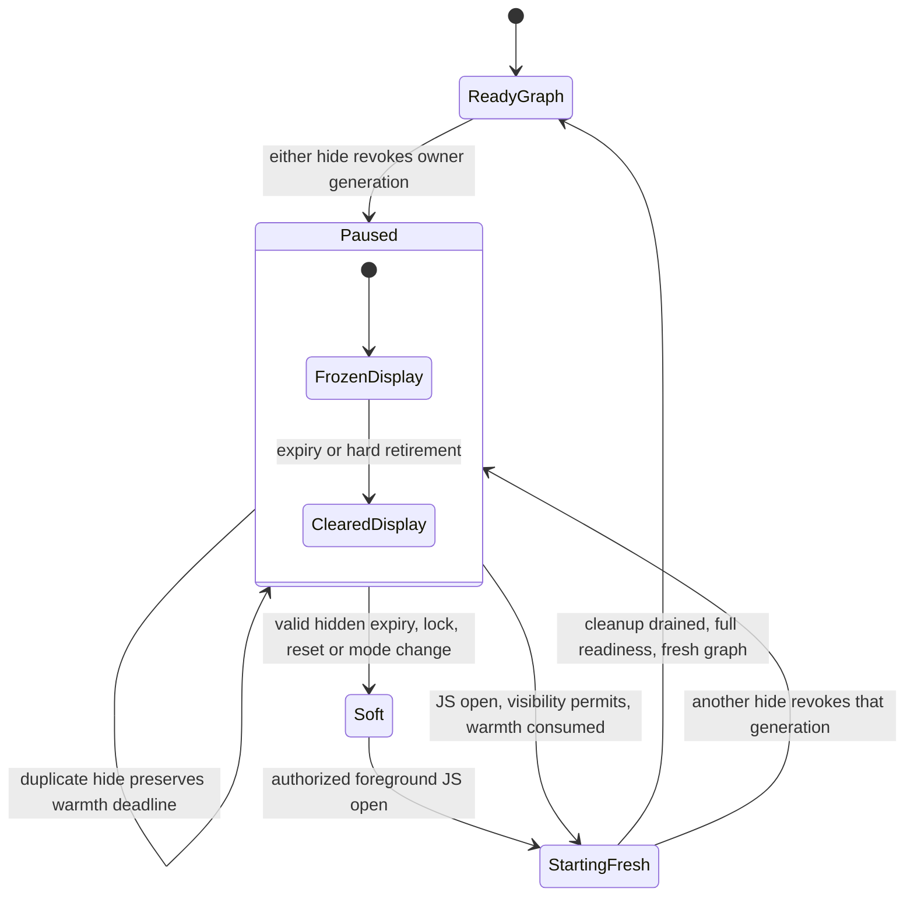

Pinned TLC v1.7.4 checked the warm-view base on November 12, 2026 using two workers and a 512 MiB heap: 537,521 generated states, 130,706 distinct states, depth 29 and an empty queue. The status base generated 30 states, found 24 distinct states and completed at depth six. Every semantic action generated successors. `ConsumeScanner` and `Unlock` discovered no new unique states but generated 483 and 15,264 successors respectively.

The warm-view base has five generations, two warmth tickets, two client identities, one abstract grace unit and clock bound two. It models one logical operation with an immutable graph owner and delayed first fetch. The deadline mutation uses grace two, allowing an unexpired duplicate at time one to extend the original deadline from two to three. The status base permits three revisions, three generations and one captured poll. Ten separate guard mutations fail their intended invariant:

| Configuration | Counterexample / expected invariant |
| --- | --- |
| `NativeWarmView_NoGraphBinding.cfg` | a prehide operation recaptures the current generation for its delayed first fetch; `NoOldGraphDispatch` |
| `NativeWarmView_NoVisibility.cfg` | a fresh graph can dispatch while a visibility signal denies activity; `NoHiddenDispatch` |
| `NativeWarmView_NoDrain.cfg` | Ready is published before old work drains; `FullDrainBeforeReady` |
| `NativeWarmView_NoReadiness.cfg` | Ready is published without a successful full-readiness result; `FullReadinessBeforeReady` |
| `NativeWarmView_NoSnapshotCapability.cfg` | display retention carries an old graph reference; `SnapshotNeverCapability` |
| `NativeWarmView_NoPresentationClear.cfg` | hard retirement or observed expiry leaves presentation/intent behind; `PresentationCleared` |
| `NativeWarmView_NoWarmDeadline.cfg` | duplicate pause extends the first deadline; `NoGraceExtension` |
| `NativeWarmView_NoExpiryFence.cfg` | a captured expiry changes newer foreground dormancy or warmth; `NoStaleDormancy` |
| `NativeWarmView_NoResumeStarts.cfg` | native Resumed starts work without a separate JS open; `NativeResumeOnlySignals` |
| `NativeWarmViewStatus_NoPollFence.cfg` | an older paused poll undoes a same-generation Resumed event; `NoPollUndoNativeEvent` |

All twelve configurations matched their expected outcomes on November 12, 2026: two green bases and ten intended invariant violations. The checker retains the earlier 78 configurations and adds these twelve, for 90 expected configurations. The prior combined gate passed on November 11; this correction rechecked the twelve affected configurations. Wider simulations each passed 20,000 traces at depth 100 with seed 20261111. Warm-view bounds widened to eight generations, four warmth tickets, three clients, grace two and clock six, checking 386,013 states. Status bounds widened to eight revisions and six generations, checking 200,001 states.

Reachability checks at the base bounds found an expired duplicate pause taking the Soft branch in four states, and two successive valid ticket expiries in fourteen states. After applying an expiry, its capture slot resets to `none`; each timer's `fired` flag prevents reuse while allowing the next ticket to be captured. Both witness searches checked all normal safety invariants before stopping at the requested witness.

The models assume immutable owner binding at the SDK/provider boundary and existing native generation checks; `NativeSession` remains required for durable unknown reservations and no automatic native mutation replay. Warmth and display retention never update that journal. Frozen display values and client/readiness/drain acknowledgements are abstract, so source serializers, consumers, Arti behavior and socket closure still require implementation/runtime verification. No physical-device behavior, latency, eventual recovery, cryptographic isolation or checked refinement is claimed. Snapshot expiry on a return is a frontend projection effect; native Resumed still performs no private I/O or Ready transition.

## Soft background continuity

`NativeContinuity.tla` replaces "every hide revokes" for a session that is already Ready with a live shown view. An ordinary background keeps the same generation, mounted graph, scopes, operations and update owner; native Resumed and JavaScript visibility only change visibility. Hides before Ready or before a view is mounted (`HideUnbound`), renderer retirement, lock, reset, mode change and destruction keep the hard path above: a new generation, drain and full readiness before a fresh graph. Startup and installer consent stay foreground-only; hidden work may finish only under its own unrevoked owner.

`RetireGraph` is the renderer retiring its own graph (startup failure, reload, mismatch on return). Paired with native invalidation it equals a same-mode `HardStop`, so it adds no distinct states (306 successors). Its mutant keeps the generation, and the generation-based bridge guard then lets the retired graph's delayed first fetch through. That is why `native_pause{warm:true}` stays generation-retiring while native `Suspended` on a Ready session does not.

`NativeContinuityStatus.tla` orders foreground metadata. It assumes native reads follow issue order; responses may resolve in any order. A poll is accepted only when no lifecycle event arrived after it was issued and no later-issued poll was already accepted.

| Model actions | Source ownership |
| --- | --- |
| `SoftHide`, `Show` | `Inner::suspend(true)` on a Ready session keeps owner and leases; `Inner::resumed`; `NativeWallet.tsx` keeps a live shown view and reconciles through `resumeNativeForeground` |
| `HideStarting`, `HideUnbound`, `HardStop`, `RetireGraph`, `Drain`, `Start`, `Bootstrap`, `Ready` | `Inner::suspend` before Ready or with `native=false`, `pause`, `invalidate`, `prepare_start`; `NativeWallet` `pause`, `suspend` (also on a hide without `liveShown()`) and `open` |
| `Mount`, `BeginOperation`, `FirstFetch` | `NativeWallet.open`; `NativeBridge.sessionGuard`; `Session::check` requires generation and Ready, not foreground |
| `BeginUpdate`, `Receive`, `Verify`, `Publish`, `Cancel`, `Install` | `createAndroidUpdateController`; `Inner::finish_update`; the Android installer foreground guard |
| Status `Flip`, `Accept`, `Issue`, `Read`, `Deliver` | `lib.rs` window lifecycle; `NativeBridge.acceptLifecycle` and `NativeBridge.status` |

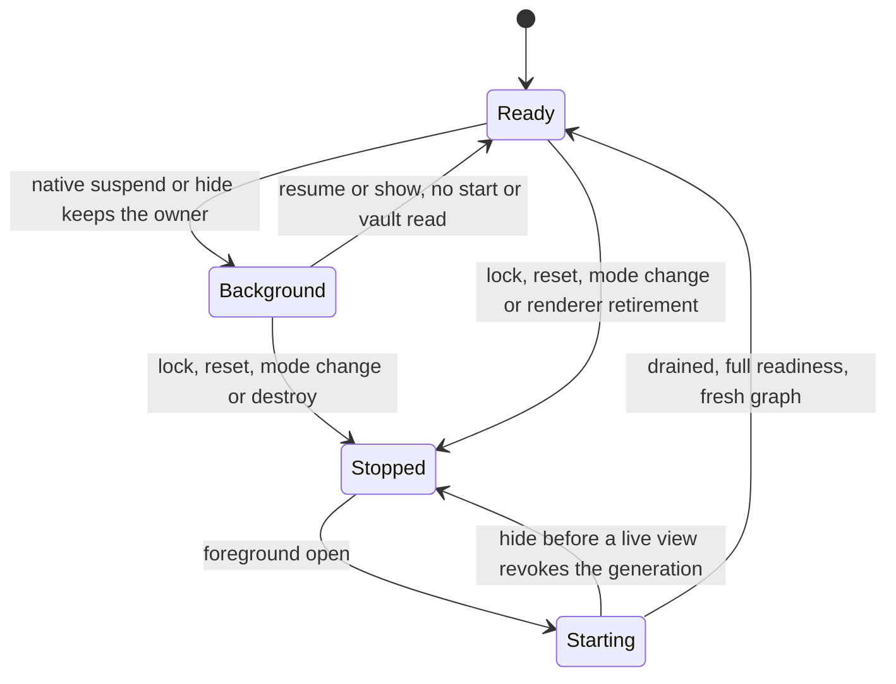

| Configuration | Counterexample / expected invariant |
| --- | --- |
| `NativeContinuity_NoSoftOwner.cfg` | a hide retires the Ready graph; `SoftOwnerRetained` |
| `NativeContinuity_NoSoftDownload.cfg` | a hide cancels the update transfer; `SoftDownloadRetained` |
| `NativeContinuity_NoResumeStarts.cfg` | a return restarts the session; `ResumeOnlyChangesVisibility` |
| `NativeContinuity_NoRetireInvalidates.cfg` | renderer retirement keeps the generation; `NoRevokedGraphDispatch` |
| `NativeContinuity_NoGraphBinding.cfg` | a first fetch rebinds to a newer generation; `NoRevokedGraphDispatch` |
| `NativeContinuity_NoUpdateFence.cfg` | a revoked update publishes; `NoRevokedUpdatePublication` |
| `NativeContinuity_NoStartVisibility.cfg` | startup completes while hidden; `StartupNeedsForeground` |
| `NativeContinuity_NoInstallVisibility.cfg` | the installer opens while hidden; `InstallerNeedsForeground` |
| `NativeContinuity_NoDrain.cfg`, `NativeContinuity_NoReadiness.cfg` | Ready before drain or readiness; `FullDrainBeforeReady`, `FullReadinessBeforeReady` |
| `NativeContinuityStatus_NoPollFence.cfg` | a poll older than a lifecycle event wins; `NoStalePollObservation` |
| `NativeContinuityStatus_NoPollOrder.cfg` | an older-issued poll overwrites a newer one; `NoStalePollObservation` |

`NoSoftOwner`, `NoSoftDownload` and `NoResumeStarts` state the contract rather than prove a guard. Pinned TLC v1.7.4 on November 12, 2026: the continuity base generated 9,180 states (3,894 distinct, depth 24) and the status base 24,243 (11,418 distinct, depth 16); every action fired. `node tools/check-native-model.mjs` matched all 104 configurations; the Tor-only update mutant was retired when updates were allowed over a direct connection. `BeginUpdate` still needs a Ready session here, and `AndroidUpdate_NoTransport.cfg` covers an update that starts while paused. Simulation passed 20,000 traces at depth 100: continuity with five generations and four bytes (2,000,001 states), status with six flips and six polls (600,001 states).

FIFO native reads are an assumption; if IPC reorders them, a stale foreground flag can persist until the next poll or lifecycle event, and opening still requires the document to be visible. Arti circuit health after a long Android freeze, OEM task killing and process death are outside these models.

## Pool spend journal release

`PoolSpendJournal.tla` is the release side of the journal `NativeSession.tla` only reserves. One spend, three parties: the wallet's journal, the pool app, and whatever hop answers in front of it. A reservation is one row; releasing it is deleting the row, so `NativeSession`'s `ReservedWhenUnresolved` still holds — the row and its reservation always go together.

`clock` is coarse: 0 inside the grace a POST must leave and answer within, 1 past the grace and inside the hour the pool answers for a spend id, 2 past both, where the pool has forgotten the id (`src/rollup/service.ts`, `sweep` and `restore`, both at 3,600,000 ms) and nothing it admitted can still reach a batch. `Dispatch` is only enabled at clock 0 because `beforeNativeMutation` stamps `createdAt` in the same `fetch` call that sends, and the grace exceeds the longest a POST can be in flight.

| Model actions | Source ownership |
| --- | --- |
| `Reserve`, `Dispatch` | `src/native/mutations.ts`: `beforeNativeMutation`; `src/native/transport.ts`: `NativeBridge.fetch` calls it before `native_http` |
| `EdgeRefuse`, `PoolRefuse`, `ForeignRefuse*` | Cloudflare's edge rate limit in front of the pool origin; `src/rollup/ohttp-gateway.ts`: `admit`; `src/rollup/http.ts`: the posts-per-minute refusal before `service.submit` |
| `Accept`, `AcceptLost`, `LoseUnseen` | `src/shielded/pool.ts`: `rollupApi`, which never resends a private mutation |
| `Land`, `Reinclude`, `PoolDrop`, `OtherBatch` | `src/rollup/service.ts`: `included`, `onDrop`, `sweep` |
| `Tick` | wall clock against `createdAt`; `TRACKED_MS` and the journal's `graceMs` |
| `Catchup` | `src/shielded/wallet.ts`: `tick`, `refreshPoolStatus`, `sync` |
| `Observe*` | `src/native/mutations.ts`: `observeNativeResponse` and `preAdmissionRefusal` |
| `ReconcileId` | `src/native/mutations.ts`: `reconcileNativeMutations` and the 404 branch of `observeNativeResponse` |
| `Settle` | `src/native/mutations.ts`: `settleLandedMutations` and `reconcileJournal`; `src/shielded/wallet.ts`: `settledNullifiers`, `settledDeposit`, `landedDeposit` |
| `RetryDispatch`, `RetryAdmit`, `RetryLand` | `src/shielded/wallet.ts`: `autoShield` rebuilding a released shield on the same coin, or a payment rebuilt on other notes |
| `ForceRelease` | `src/native/mutations.ts`: `forceRelease`; the Release reserved shields action in `app/src/RollupWallet.tsx` |

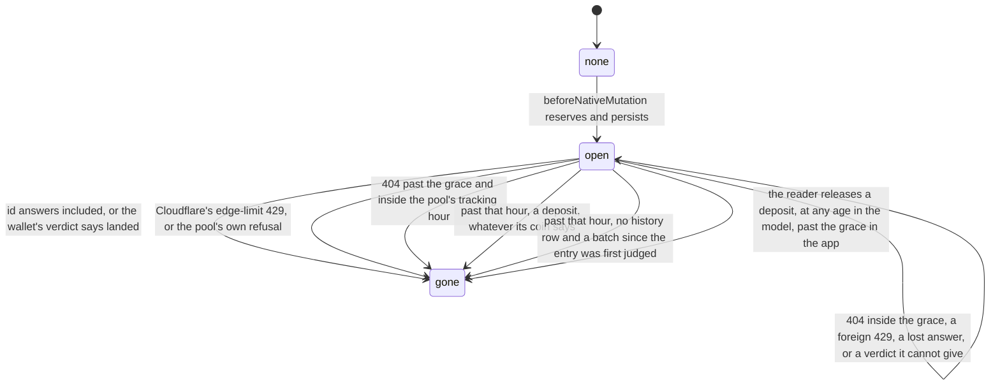

| Configuration | Counterexample / expected invariant |
| --- | --- |
| `PoolSpendJournal_Grace.cfg` | a 404 releases while the POST is still in flight; `NoDoublePayment` |
| `PoolSpendJournal_TrackedWindow.cfg` | a 404 past the tracking hour releases a spend that landed; `NoDoublePayment` |
| `PoolSpendJournal_ForeignRefusal.cfg` | a 429 from a hop that may have forwarded releases; `NoDoublePayment` |
| `PoolSpendJournal_EdgeRefusal.cfg` | a recognised edge-limit 429 leaves the row reserved for good; `NoStrandedReservation` |
| `PoolSpendJournal_Retention.cfg` | settle releases before the pool can have forgotten it; `NoDoublePayment` |
| `PoolSpendJournal_CoinProof.cfg` | a deposit waits for a batch an idle pool never makes; `NoStrandedReservation` |
| `PoolSpendJournal_ForceNotes.cfg` | the reader's release reaches a payment, past the window; `NoDoublePayment` |
| `PoolSpendJournal_UnreadableCoin.cfg` | a deposit whose coin read fails keeps its row past the hour; `NoStrandedReservation` |

`paid` counts landings, so `NoDoublePayment` is the real promise rather than a proxy for it: a first attempt and a retry after a release never both land. The asymmetry the deposit rule rests on is in `Land` and `RetryLand`, which a deposit may take only while its coin is unspent. A note spend has no such bound — it can be rebuilt on other notes — so it keeps the verdict and count rules. A retry follows only a release that declared the payment dead, never one that proved it landed.

Pinned TLC v1.7.4 on November 13, 2026: the base generated 27,307 states (6,388 distinct) with every action fired. `node tools/check-native-model.mjs` matched all 127 configurations. The reader's release is offered for deposits only. An earlier revision also let it free a payment past the window on a current unlanded verdict, and this model stays green on that rule — which is the argument against it, not for it: the hazard such a rule misses is a stalled operator's count, exactly what `count # batchAt` in `settleLandedMutations` guards and exactly what this model scopes out. A manual path cannot re-derive a proof the model cannot see, so payments are left to the settle rule, which runs every minute anyway. `ForceRelease` frees a deposit at any age, its POST still in flight included. That is a deliberate over-approximation: `forceRelease` in the app also keeps a shield younger than the grace, so there its POST has already left and answered, and the model staying green without that wait shows the coin, not the grace, bounds a retry. Because a released row can still have its POST in flight here, `DispatchJournaled` is not an invariant of this model; `NativeSession.tla`'s own `DispatchJournaled` still owns "journal before send". `Settle` may read a deposit's coin as `unknown` on any pass, as `reconcileJournal` turns a failed read into `undefined`; past the hour that releases all the same.

The model assumes a recognised edge-limit 429 (Cloudflare's `error code: 1015`) was written before the request was forwarded, which is what makes `ObserveEdgeRefusal` safe; any other 429 is modelled as possibly forwarded and left to the 404 window or the coin. It assumes the Ark indexer's answer for a deposit coin is not stale by anything near the tracking hour, and that the operator a wallet reads is the one that batches: the account's view is a prefix of the truth, and a wallet behind the count it reads gives no verdict at all.

With that last assumption dropped — a frozen replica serving a count the wallet has fully synced while another operator keeps batching — the model finds a `NoDoublePayment` trace against the existing count rule: the wallet advances 0 → 1, the spend lands in batch 2 that the replica never serves, and `count # batchAt` then reads as proof the view is current. That rule is unchanged here and the hazard is the one its comment already names; the deposit path does not rely on it, because a coin read answers past any operator. Amounts, group members, several concurrent spends per origin, storage durability and the Ark layer's own refusal to spend a coin twice are outside this model. So is the operator's rule that a batch takes one slot per coin (`selectRollupBatch` in `src/rollup/batcher.ts`, tested in `tests/rollup-batcher.test.ts` and `tests/rollup-epoch-operator.test.ts`): `paid` counts landings, and two slots on one coin cannot both land, but one batch carrying both is refused by the network. Admission cannot tell a coin's owner, so both slots queue and signing drops the one its owner did not sign.

## Isolated indexer streams

`IndexerStreams.tla` covers one logical script subscription whose scripts stream or poll separately, when one script's transport fails: two scripts, one failing, and an indexer change landing in the gap.

| Model action | Owning file and symbol |
| --- | --- |
| `Fail` | `src/native/providers.ts`: the per-script loop in `IsolatedIndexerProvider::getSubscription` (`stream.attach`) |
| `Backoff` | `src/native/providers.ts`: `isolatedBackoff`, `pollDelay` |
| `Reopen`, `ReopenReplays` | `src/native/providers.ts`: the `base.getSubscription` re-open at the head of the per-script loop |
| `CatchUpRead`, `CatchUpFails` | `src/native/providers.ts`: `IsolatedIndexerProvider::readScript` against the per-stream snapshots |
| `LoseBaseline` | `src/native/providers.ts`: a failed seed read, leaving `snapshots` without an entry for the script |
| `StartRead`, `FoldRead` | `src/native/providers.ts`: `readScript` capturing `folds` on entry and folding through `foldInto` on exit |
| `AbsorbSpend` | `src/native/providers.ts`: `absorb` bumping `folds` as each stream event lands |
| `Escalate` | `src/native/providers.ts`: `queue.fail` after `ISOLATED_RETRIES`, or on `MissedScriptEvent` |
| `SdkReset` | SDK `ContractWatcher.listenLoop` to `emitConnectionReset` to `ContractManager.reconcileWatched` |
| `Event` | An arkd indexer change for one script; off-stream it is lost at the server until a read recovers it |
| `Terminal` | Artificial bound termination; no implementation counterpart |

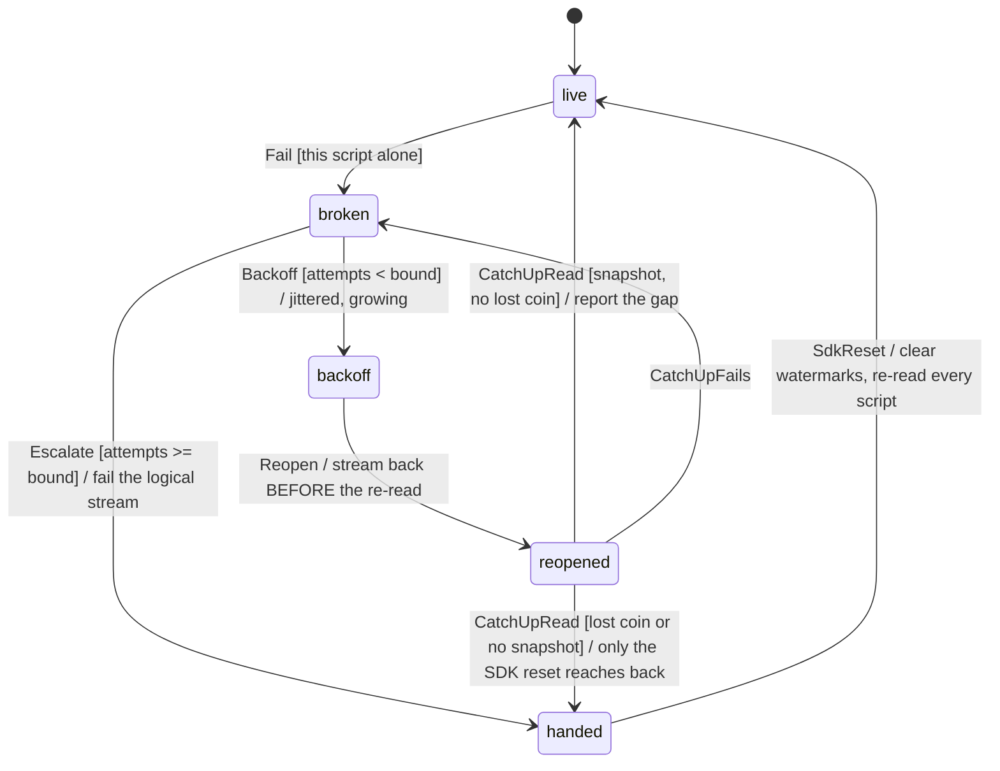

`NoMissedEvent` is the promise: a script back on its stream owes nothing from the gap it was away for. `BoundedIsolatedRetry` says a script that cannot resume is handed to the SDK rather than retried in silence. `NoStaleSnapshot` says an in-flight read never walks the snapshot back over what the stream already advanced, which is what keeps a spend from being re-announced or shown unspent. `NoCollateralTeardown` is a cost promise, not a safety one: tearing every sibling down, the behavior before this change, still reaches the SDK reset and so keeps `NoMissedEvent`. Its own invariant is what makes `BreakIsolation` a live guard instead of a dead one.

| Configuration | Counterexample / expected invariant |
| --- | --- |
| `IndexerStreams_NoCatchUp.cfg` | Fail, Backoff, Event, then the read resumes owing the event; `NoMissedEvent` |
| `IndexerStreams_NoLostEscalation.cfg` | a coin that vanished during the gap resumes undescribed; `NoMissedEvent` |
| `IndexerStreams_NoRetryBound.cfg` | a dead script is retried past the budget with nothing handed over; `BoundedIsolatedRetry` |
| `IndexerStreams_NoIsolation.cfg` | one script's failure detaches its sibling; `NoCollateralTeardown` |
| `IndexerStreams_NoReopenOrder.cfg` | the read answers, an event lands, then the stream reopens; `NoMissedEvent` |
| `IndexerStreams_NoBaseline.cfg` | a script with no snapshot resumes, so a vanished coin goes unseen; `NoMissedEvent` |
| `IndexerStreams_NoMonotonicFold.cfg` | Reopen, StartRead, AbsorbSpend, then FoldRead walks the spend back; `NoStaleSnapshot` |

Pinned TLC v1.7.4 and Java 25 on November 13, 2026: the base run fired every action and each of the seven mutations violated its named invariant; `node tools/check-native-model.mjs` matched all 120 configurations. `FoldRead` fires but adds no novel states in the base: refusing a downgrade is a no-op on the snapshot, so its effect is only observable under `BreakMonotonicFold`, the same shape as the `Terminal` self-loop above. Simulation passed 20,000 traces at depth 100 with three scripts and a wider budget. The `trace-No*.md` files hold the shortest counterexamples, and `tests/native-providers.test.ts` drives the real provider through the same steps.

The read is ordered AFTER the stream reopens, so the model needs no assumption about arkd replaying a still-registered subscription id: `ReopenReplays` is optional and `NoMissedEvent` holds without it. `IndexerStreams_NoReopenOrder.cfg` is the read-first ordering, whose `read` phase is the window an event falls into. For a polled script the read IS the stream, so `Reopen` and `CatchUpRead` coincide and that window does not exist. Snapshot staleness beyond what the stream events and the reads fold in, per-origin HTTP rate limits, Tor circuit health, the indexer's own retention and liveness are outside this model.
